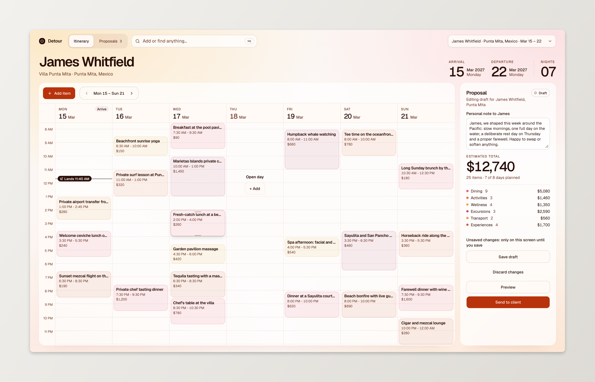
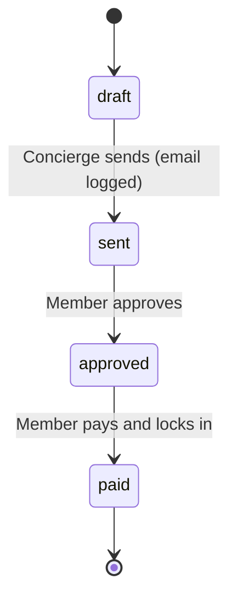

<div align="center">

# Detour

**Concierge itinerary proposals for luxury resort travel.**<br />
Build a curated stay, send it to the member, and watch it go from draft to locked in.

[**Live demo →**](https://itinerary-proposal-system.vercel.app/)


</div>

<br />



<br />

## Overview

Detour is a small internal tool for a resort-travel concierge team. A concierge assembles an itinerary for a member's upcoming stay, sends it as a proposal, and the member reviews it, approves it, and pays to lock it in.

The whole loop works end to end:

```
create  →  send  →  approve  →  pay
```

Email and payment are simulated. Everything else is real: persistence, validation, a strict state machine, and optimistic UI.

Two views, deliberately different in tone:

|               | Route                      | Audience                   | Feel                                      |
| ------------- | -------------------------- | -------------------------- | ----------------------------------------- |
| **Concierge** | `/planning`                | A professional moving fast | Calm, dense, keyboard-friendly            |
| **Member**    | `/proposal/[id]` (emailed) | A guest of a luxury brand  | Premium, quiet, mobile-first, slow motion |

## Live demo

[itinerary-proposal-system.vercel.app](https://itinerary-proposal-system.vercel.app/) always serves the latest `main`. Data is seeded on each build and resets on cold starts (see [Deployment](#deployment)).

## Quick start

**Requirements:** Node.js `26.13.0` (see `.nvmrc`) and npm.

```bash
cp .env.example .env
npm install
npm run dev
```

Open [http://localhost:3000](http://localhost:3000). `npm run dev` generates the Prisma client, applies migrations, and seeds the database before starting the server, so there is nothing else to set up.

### Try the full flow

1. Open `/planning` and pick a client (James Whitfield is the primary demo).
2. Open the seeded draft, tweak the itinerary, and hit **Send**.
3. Copy the client link from the success dialog and open it, ideally at phone width.
4. As the member: **Approve**, then **Pay & Lock In**, then enjoy the confirmation.

The sent email is also logged to the server console.

## Commands

### App

| Command                       | What it does                                    |
| ----------------------------- | ----------------------------------------------- |
| `npm run dev`                 | Prepare the database, then start the dev server |
| `npm run build` / `npm start` | Production build / serve                        |

### Database

| Command               | What it does                                                               |
| --------------------- | -------------------------------------------------------------------------- |
| `npm run db:prepare`  | Generate client, apply migrations, seed. Idempotent, safe to re-run        |
| `npm run db:reset`    | Drop the database, re-apply all migrations, and re-seed. **Destroys data** |
| `npm run db:seed`     | Seed members, reservations, and one draft proposal each                    |
| `npm run db:migrate`  | Create and apply a new migration after editing `prisma/schema.prisma`      |
| `npm run db:deploy`   | Apply existing migrations without creating new ones                        |
| `npm run db:generate` | Regenerate the Prisma client                                               |
| `npm run db:studio`   | Browse and edit data in Prisma Studio                                      |

### Quality

| Command                           | What it does                            |
| --------------------------------- | --------------------------------------- |
| `npm run check`                   | Lint + typecheck + tests (what CI runs) |
| `npm run lint` / `lint:fix`       | ESLint                                  |
| `npm run typecheck`               | `next typegen` + `tsc --noEmit`         |
| `npm test` / `test:watch`         | Vitest                                  |
| `npm run format` / `format:check` | Prettier                                |

Commits follow [Conventional Commits](https://www.conventionalcommits.org/), enforced by commitlint. Husky and lint-staged lint and format staged files before each commit.

### Configuration

| Variable       | Default                 | Purpose                                        |
| -------------- | ----------------------- | ---------------------------------------------- |
| `DATABASE_URL` | `file:./dev.db`         | SQLite database file                           |
| `APP_BASE_URL` | `http://localhost:3000` | Base for the member link inside the sent email |

## Screens

### Concierge

- **Week planner.** Seven days per page, 7 AM to midnight. Drag blocks between days and times, resize from the edges (15-minute snap), and see overlapping items split side by side. Flight arrival and departure are drawn as lines across the day.
- **Item sheet.** Category pills, title, description, date, start and end time, price. Times are constrained to the trip.
- **Proposal panel.** Note to the member, running total, per-category breakdown, and **Preview**, **Save draft**, **Send** actions with a clear saved / unsaved cue.
- **Command palette (`⌘K`).** Commands plus quick add: type `sunset cocktails fri 7pm 260` and get a parsed item with category, day, time, and price.
- **Proposals tab.** Every proposal across all clients with status, item count, total, and last activity.
- **Trip header and client switcher.** Destination, villa, member, arrival, departure, and nights, always visible.
- **Preview and send dialogs.** Preview renders the exact component the member sees. Send shows the recipient, the email, and the client link.

### Member

- **Sent.** The itinerary as swipeable day **cards** or a day-by-day **timeline**, with the concierge note and a sticky bar with the total and **Approve**.
- **Approved.** The itinerary collapses into a gradient **trip pass**; the bar offers **Pay & Lock In**.
- **Paid.** A "Locked" stamp, then an animated **confirmation postcard** with a confirmation number and trip summary.
- **Not available.** Drafts and unknown ids show a quiet message that reveals nothing.

Every screen has loading, empty, and error states.

## Proposal lifecycle



- Every transition lives in one pure table, `src/lib/proposals/state-machine.ts`, shared by the API and the UI. Illegal moves return `409 INVALID_TRANSITION`.
- Writes are conditional (`where: { id, status: from }`), so two concurrent approvals cannot both succeed.
- Send is a single transaction: status change and email record together or not at all.
- Sent proposals are immutable. The member approves exactly what they saw.
- Status changes update the UI optimistically and roll back on failure.

Details: [`docs/proposal-lifecycle.md`](docs/proposal-lifecycle.md).

## Stack

| Layer        | Tools                                                             |
| ------------ | ----------------------------------------------------------------- |
| Framework    | Next.js (App Router, route handlers), React 19                    |
| Language     | TypeScript (strict)                                               |
| UI           | Tailwind CSS 4, shadcn/ui on Base UI, Lucide icons, Geist         |
| Data         | Prisma 7 with SQLite (`better-sqlite3` adapter)                   |
| Validation   | zod, with one schema per API contract shared by server and client |
| Client state | TanStack Query                                                    |
| Testing      | Vitest, including API tests against the real route handlers       |
| Tooling      | ESLint, Prettier, Husky, lint-staged, commitlint, GitHub Actions  |

### Architecture

One Next.js project and one process: UI and API together, no separate server, queue, or cache.

```
components  →  hooks  →  lib/api-client  →  route handler  →  lib/proposals  →  lib/db
```

| Path                  | Role                                                               |
| --------------------- | ------------------------------------------------------------------ |
| `src/app/`            | Routing only: pages, layouts, thin route handlers                  |
| `src/components/`     | UI only, one component per file                                    |
| `src/hooks/`          | Component logic: state, queries, mutations, handlers               |
| `src/lib/proposals/`  | Framework-agnostic business logic (state machine, totals, parsing) |
| `src/lib/schemas/`    | zod schemas and API contracts                                      |
| `src/lib/api-client/` | Typed fetch client used by hooks                                   |
| `src/lib/db/`         | Prisma client singleton                                            |
| `prisma/`             | Schema, migrations, seed                                           |

### API

| Method & path                   | Purpose                                      |
| ------------------------------- | -------------------------------------------- |
| `GET /api/reservations`         | Reservations with members                    |
| `GET /api/proposals`            | Proposal summaries, optional `reservationId` |
| `POST /api/proposals`           | Create a draft with its items                |
| `GET /api/proposals/[id]`       | One proposal with items and total            |
| `PUT /api/proposals/[id]`       | Replace the note and items of a draft        |
| `PATCH /api/proposals/[id]`     | Member transition to `approved` or `paid`    |
| `POST /api/proposals/[id]/send` | `draft` → `sent` and log the email           |

Errors share one shape with stable codes: `VALIDATION_ERROR`, `NOT_FOUND`, `INVALID_TRANSITION`, `NOT_EDITABLE`, `EMPTY_PROPOSAL`, `INTERNAL_ERROR`. See [`docs/api.md`](docs/api.md).

## Deployment

`main` is deployed to [itinerary-proposal-system.vercel.app](https://itinerary-proposal-system.vercel.app/). The repo includes a Vercel configuration. The build runs `db:prepare` and bundles a SQLite snapshot with the functions. Vercel's filesystem is read-only, so writes are per-instance and reset on cold starts. That is fine for a demo; real use needs a hosted database.

## AI-assisted development

The repo is set up so AI coding agents (built around Claude Code) follow the same rules as human contributors.

### Instructions

- [`AGENTS.md`](AGENTS.md) is the single source of truth: stack, commands, folder responsibilities, and code conventions. `CLAUDE.md` imports it.
- [`docs/`](docs/) holds intent and rationale. Agents read the matching doc before a task and update it in the same change when behavior changes.

### Skills

Project skills in `.claude/skills/` encode the repeatable procedures:

| Skill                 | Use for                                                                          |
| --------------------- | -------------------------------------------------------------------------------- |
| `add-api-route`       | New or changed endpoint: zod schema, domain function, thin handler, client, test |
| `db-change`           | Schema edits, migrations, seed, and data-model doc                               |
| `frontend`            | New screens: component, hook, TanStack Query, states, theme tokens, mobile-first |
| `manual-testing`      | Running the app and clicking through the full flow, including DB reset           |
| `project-code-review` | Lint, typecheck, tests, build, then a diff review against `AGENTS.md`            |
| `git-workflow`        | Conventional Commits, branch names, PR template                                  |

The official Prisma skills (CLI, Client API, setup, upgrade) are vendored alongside them and pinned in `skills-lock.json`.

### Hooks

Configured in `.claude/settings.json`, implemented in `.claude/hooks/`:

| Hook              | When                 | What it does                                                   |
| ----------------- | -------------------- | -------------------------------------------------------------- |
| `format-file.mjs` | After edit / write   | Runs Prettier and `eslint --fix` on the touched file           |
| `guard-git.mjs`   | Before shell calls   | Blocks skipping commit hooks and force-pushing                 |
| `typecheck.mjs`   | When the agent stops | Runs `tsc --noEmit` and sends any type errors back to be fixed |

These sit on top of the regular Git hooks (Husky: commitlint, lint-staged, typecheck), so the same checks apply whether a human or an agent commits.

## Documentation

Design intent and rationale live in [`docs/`](docs/):

| Doc                                                   | Covers                                           |
| ----------------------------------------------------- | ------------------------------------------------ |
| [`product.md`](docs/product.md)                       | Scenario, roles, glossary, scope                 |
| [`data-model.md`](docs/data-model.md)                 | Entities and modeling rules                      |
| [`proposal-lifecycle.md`](docs/proposal-lifecycle.md) | State machine, errors, optimistic updates        |
| [`api.md`](docs/api.md)                               | Routes, error format and codes                   |
| [`design.md`](docs/design.md)                         | Concierge and member design direction            |
| [`decisions.md`](docs/decisions.md)                   | What was chosen and why, assumptions, next steps |

## Scope and known gaps

Out of scope by design: real email and payments, authentication, managing members and reservations from the UI, multi-currency, proposal versioning, and i18n. The unguessable proposal id acts as the member's access link.

Next steps: real auth with expiring links, an email and payment provider, cancel and re-send, pagination, and Playwright end-to-end tests. The full list is in [`docs/decisions.md`](docs/decisions.md).
