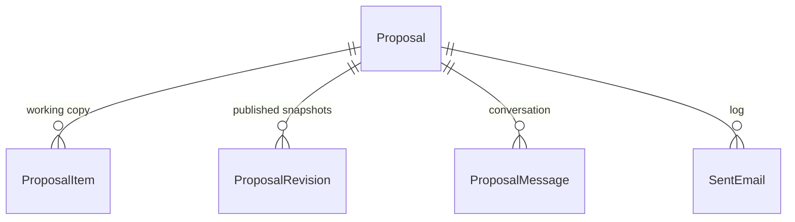

# Spec 001 appendix

Reference material for [spec.md](spec.md). If the two ever disagree, `spec.md` wins and this file is the bug.

|                                                                                  |                                                                |
| -------------------------------------------------------------------------------- | -------------------------------------------------------------- |
| [A. Non-goals](#a-non-goals)                                                     | [H. Acceptance criteria](#h-acceptance-criteria)               |
| [B. Entry kinds](#b-entry-kinds)                                                 | [I. Test plan and traceability](#i-test-plan-and-traceability) |
| [C. Data model details](#c-data-model-details)                                   | [J. Docs to update](#j-docs-to-update)                         |
| [D. Edge cases](#d-edge-cases)                                                   | [K. Rollout and migration](#k-rollout-and-migration)           |
| [E. Decisions and alternatives](#e-decisions-and-alternatives)                   | [L. Implementation slices](#l-implementation-slices)           |
| [F. Surface behavior details](#f-surface-behavior-details)                       | [M. API payloads](#m-api-payloads)                             |
| [G. Security, accessibility, performance](#g-security-accessibility-performance) |                                                                |

## A. Non-goals

| Not doing                                         | Why                                                                                                                                            |
| ------------------------------------------------- | ---------------------------------------------------------------------------------------------------------------------------------------------- |
| Real-time delivery (WebSocket/SSE)                | One process, SQLite, no auth. Polling is enough for a negotiation measured in minutes ([D-4](#e-decisions-and-alternatives)).                  |
| Unread counters, read receipts, typing indicators | Need per-viewer identity, which the app deliberately lacks.                                                                                    |
| Edit or delete messages                           | A negotiation log is evidence. Append-only is simpler and safer.                                                                               |
| Attachments, rich text, mentions                  | Plain text covers the need.                                                                                                                    |
| Concierge-initiated withdrawal or expiry          | Separate feature ("cancel/expire" in the known gaps). Includes recalling a mistaken revision ([OQ-4](spec.md#7-highlights-from-the-appendix)). |
| Per-item identity across revisions (true diffs)   | Item ids are unstable by design. The change summary is deliberately coarse ([D-5](#e-decisions-and-alternatives)).                             |
| Optimistic locking between two concierge tabs     | Today a draft is last-write-wins, and this feature keeps that ([E-19](#d-edge-cases)).                                                         |
| Real authentication of authors                    | Out of scope app-wide. Consequences in [G](#g-security-accessibility-performance).                                                             |
| Email for every chat message                      | Notifications are out of scope ([OQ-3](spec.md#7-highlights-from-the-appendix)).                                                               |

## B. Entry kinds

Every entry has an author role (`member`, `concierge` or `system`), an author name, a body (null for system entries), a `revision` and a timestamp. System entries use the author name "System".

| `kind`              | Group      | Author              | Body                     | Created by              | `revision` holds                                             |
| ------------------- | ---------- | ------------------- | ------------------------ | ----------------------- | ------------------------------------------------------------ |
| `chat`              | chat       | member or concierge | required                 | `POST /messages`        | the latest revision when written                             |
| `changes_requested` | transition | member              | required                 | `POST /request-changes` | the revision the member displayed (the latest, by the guard) |
| `declined`          | transition | member              | required                 | `POST /decline`         | the revision the member displayed                            |
| `revision_sent`     | transition | concierge           | required (cover message) | `POST /resend`          | the **new** revision, N+1                                    |
| `sent`              | transition | system              | none                     | `POST /send`            | 1                                                            |
| `approved`          | transition | system              | none                     | approve transition      | the revision approved                                        |
| `paid`              | transition | system              | none                     | pay transition          | the revision paid                                            |

`revision` is **the revision the entry was written against**. For a chat entry that is whichever revision was latest at that moment: a member who still displays revision 1 and posts after revision 2 arrived gets revision 2 stamped. That is accurate for the conversation and harmless, because chat is not a decision about a version.

Transition entries are written in the same transaction as their status change. Only `chat` entries count toward the 500 cap ([FR-10](spec.md#2-requirements)).

**Display text.** System and transition entries render as short lines in the thread: "Proposal sent" (`sent`), "Approved", "Paid", "Changes requested" with the message, "Declined" with the message, and "Revision N sent by {signature}" with the cover message (`revision_sent`).

## C. Data model details

Follow the `db-change` skill when building.



| Change                         | Notes                                                                                                                                                                                                                                                                                                                                                                            |
| ------------------------------ | -------------------------------------------------------------------------------------------------------------------------------------------------------------------------------------------------------------------------------------------------------------------------------------------------------------------------------------------------------------------------------- |
| **`ProposalRevision`**         | `proposalId`, `number`, note, items snapshot, `schemaVersion`, `coverMessage` and `signature` (both **null** for revision 1), `sentAt`. Unique on `(proposalId, number)`. Total is derived, never stored.                                                                                                                                                                        |
| **`ProposalMessage`**          | `proposalId`, `kind`, `authorRole`, `authorName`, `body` (null for system entries), `revision` (see [B](#b-entry-kinds)), `clientId` (nullable, never set in P1; the P2 slice adds a unique index on `(proposalId, clientId)`, and the conflict check compares the author role, author name and body already on the entry), `createdAt`. Index on `(proposalId, createdAt, id)`. |
| **`Proposal.currentRevision`** | Integer with database default 0 (0 until the first send). Denormalized for the one-statement guard ([D-7](#e-decisions-and-alternatives)). Invariant tested.                                                                                                                                                                                                                     |
| **`Proposal.declinedAt`**      | One-shot timestamp.                                                                                                                                                                                                                                                                                                                                                              |
| **`SentEmail.revision`**       | Integer with database default 1 (`@default(1)`), which gives existing rows 1; the code always sets it explicitly.                                                                                                                                                                                                                                                                |
| **`status` values**            | `changes_requested` and `declined`, lowercase strings defined once in `src/lib/schemas/proposal.ts` (no DB enums, per existing decision).                                                                                                                                                                                                                                        |

Rules:

- **Items snapshot format.** A JSON array of `ItemSnapshot` objects ([M](#m-api-payloads)), ordered by `scheduledAt` ascending with ties broken by item id ascending, so the SQL backfill and the TypeScript writer can produce the same order. `scheduledAt` is an ISO 8601 UTC string with milliseconds and a trailing `Z`, the same format the API uses. The migration SQL and the TypeScript writer MUST produce this identical shape, and one test reads a backfilled snapshot through the TypeScript reader. `schemaVersion` starts at 1.
- **Cover message and signature are stored twice on purpose.** A `resend` writes them on the new revision (so the revision view needs no join) and on the `revision_sent` entry (so the conversation renders on its own), from the same input in the same transaction. Both are append-only, so they cannot drift ([D-15](#e-decisions-and-alternatives)).
- **Repeatable events have no timestamp column.** `sentAt`, `approvedAt`, `paidAt` and `declinedAt` happen at most once. `Proposal.sentAt` keeps meaning "first sent"; each revision carries its own `sentAt`.
- **Working copy equals latest revision** in every status except `draft` and `changes_requested`, the two editable ones. The ways out of an editable status are send and resend (which snapshot the working copy) and T6, which resets the working copy to the latest revision ([D-14](#e-decisions-and-alternatives)).
- **Append-only.** No domain function updates or deletes a `ProposalRevision` or a `ProposalMessage`. No route deletes a proposal, so nothing cascades.
- **Change summary function.** Items are compared as a **multiset** on full content (category, title, description, scheduled time, price, duration): order is ignored and duplicates count. The result is `{ added, removed, totalDifferenceCents, noteChanged }` ([M](#m-api-payloads)). "No itinerary changes" means `added` and `removed` are both empty; `noteChanged` is separate, so a note-only edit reads "No itinerary changes" plus "Note updated". An edited item appears as one removed and one added.
- **Snapshot compatibility.** Revisions are immutable but the item schema is not. Reads go through one upgrade function keyed by `schemaVersion`, and later changes to the item schema must be backward compatible (new fields optional with a default). A snapshot that fails to parse is a logged `INTERNAL_ERROR`, never a silent blank page.
- **Ordering.** Entries sort by `(createdAt, id)`. A live entry's `createdAt` is assigned inside its transaction, after the guard write, as the later of the current time and one millisecond after the proposal's newest entry. Writers are serialized, so live entries never tie and never go backwards: the order is exactly the order of commits. Only backfilled entries can share a timestamp, and they use ordinal ids ([K](#k-rollout-and-migration)), so the id tiebreak is exact.
- **`lastActivityAt`** is derived: `updatedAt` for a draft, the newest entry's `createdAt` for a sent proposal.
- **Demo seed (P1, slice 10).** One extra proposal for Amelia Hart's reservation (Villa Cabo Azul) with the fixed id `proposal_amelia_cabo_negotiation` (no status in the id, per [data-model.md](../../data-model.md)); James's primary demo draft and the other seeded drafts are untouched. It is built through the domain functions (create with the seed's explicit id, send, a member request-changes, a concierge chat reply), so it carries real revisions and entries. The seed stays idempotent: it creates the proposal only if its id is missing.

## D. Edge cases

| #    | Situation                                                                      | Expected behavior                                                                                                                                                                                                                                                                                                                                                                                                                                                                                                                                                                                                                                                                                                                                                                                                                                                                                                                                                                                                                                                                                                                                                                    |
| ---- | ------------------------------------------------------------------------------ | ------------------------------------------------------------------------------------------------------------------------------------------------------------------------------------------------------------------------------------------------------------------------------------------------------------------------------------------------------------------------------------------------------------------------------------------------------------------------------------------------------------------------------------------------------------------------------------------------------------------------------------------------------------------------------------------------------------------------------------------------------------------------------------------------------------------------------------------------------------------------------------------------------------------------------------------------------------------------------------------------------------------------------------------------------------------------------------------------------------------------------------------------------------------------------------ |
| E-1  | Member approves while another tab (or a stale page) requests changes           | Exactly one wins by conditional write. The loser gets `INVALID_TRANSITION`, refetches and converges. Exactly one transition entry exists afterwards.                                                                                                                                                                                                                                                                                                                                                                                                                                                                                                                                                                                                                                                                                                                                                                                                                                                                                                                                                                                                                                 |
| E-2  | Member acts on a revision that is no longer the latest                         | `STALE_REVISION`, nothing written. The UI shows the banner and keeps the typed text without sending it ([spec §6](spec.md#6-behavior-by-surface)).                                                                                                                                                                                                                                                                                                                                                                                                                                                                                                                                                                                                                                                                                                                                                                                                                                                                                                                                                                                                                                   |
| E-3  | Two concierge tabs resend at once                                              | One creates revision N+1. The other gets `INVALID_TRANSITION` (status is already `sent`). The unique constraint is the backstop.                                                                                                                                                                                                                                                                                                                                                                                                                                                                                                                                                                                                                                                                                                                                                                                                                                                                                                                                                                                                                                                     |
| E-4  | Member declines while the concierge is editing                                 | The concierge's next save returns `NOT_EDITABLE`. The decline already reset the working copy to the latest revision, so nothing unsent remains. The builder switches to the latest revision, read-only, with the decline reason.                                                                                                                                                                                                                                                                                                                                                                                                                                                                                                                                                                                                                                                                                                                                                                                                                                                                                                                                                     |
| E-5  | A chat message is posted as the status becomes `paid`                          | Both begin with a conditional write, so one runs entirely before the other. The chat either commits before the `paid` entry (and sorts before it) or gets `CONVERSATION_CLOSED`. It never appears after a terminal entry. The rejected text stays in the composer.                                                                                                                                                                                                                                                                                                                                                                                                                                                                                                                                                                                                                                                                                                                                                                                                                                                                                                                   |
| E-6  | Resend with zero items                                                         | `EMPTY_PROPOSAL` (422). Full rollback: the status is still `changes_requested`, `currentRevision` is unchanged, and there is no revision, email or entry.                                                                                                                                                                                                                                                                                                                                                                                                                                                                                                                                                                                                                                                                                                                                                                                                                                                                                                                                                                                                                            |
| E-7  | Resend with unchanged content                                                  | Allowed. Labeled "No itinerary changes", plus "Note updated" if only the note differs.                                                                                                                                                                                                                                                                                                                                                                                                                                                                                                                                                                                                                                                                                                                                                                                                                                                                                                                                                                                                                                                                                               |
| E-8  | Response lost after a successful chat post, then retry                         | Same `clientId` and identical payload: the server returns the existing entry, even if the conversation closed in between. Same `clientId`, different author role, author name or body: `IDEMPOTENCY_CONFLICT`. Two concurrent requests with the same `clientId`: the loser of the unique index re-reads the winner and applies the same rule. In P1 `clientId` is ignored.                                                                                                                                                                                                                                                                                                                                                                                                                                                                                                                                                                                                                                                                                                                                                                                                           |
| E-9  | Member opens the link in `changes_requested` before any concierge reply        | Sees the last revision, their own request and "Your concierge is working on your request".                                                                                                                                                                                                                                                                                                                                                                                                                                                                                                                                                                                                                                                                                                                                                                                                                                                                                                                                                                                                                                                                                           |
| E-10 | The revision 1 email is opened after revision 2 exists                         | Same URL, shows the latest revision. Correct by design.                                                                                                                                                                                                                                                                                                                                                                                                                                                                                                                                                                                                                                                                                                                                                                                                                                                                                                                                                                                                                                                                                                                              |
| E-11 | Whitespace-only, empty or too-long body or signature                           | `VALIDATION_ERROR`. Nothing written.                                                                                                                                                                                                                                                                                                                                                                                                                                                                                                                                                                                                                                                                                                                                                                                                                                                                                                                                                                                                                                                                                                                                                 |
| E-12 | Anything posted to, or read from, the conversation or revisions of a draft     | `404 NOT_FOUND`, identical to an unknown id, so these endpoints reveal nothing about a draft. (`GET /api/proposals/[id]` is still open, see [G](#g-security-accessibility-performance).)                                                                                                                                                                                                                                                                                                                                                                                                                                                                                                                                                                                                                                                                                                                                                                                                                                                                                                                                                                                             |
| E-13 | Two entries with the same timestamp                                            | Live entries never tie, because `createdAt` is monotonic per proposal ([C](#c-data-model-details)). Backfilled entries that share a timestamp sort by their ordinal id.                                                                                                                                                                                                                                                                                                                                                                                                                                                                                                                                                                                                                                                                                                                                                                                                                                                                                                                                                                                                              |
| E-14 | Declined proposal, concierge wants to continue                                 | Create a new proposal for the reservation. No link between the two conversations (non-goal).                                                                                                                                                                                                                                                                                                                                                                                                                                                                                                                                                                                                                                                                                                                                                                                                                                                                                                                                                                                                                                                                                         |
| E-15 | Response lost after a successful transition or resend, then the client retries | The retry gets a `409`: `INVALID_TRANSITION` if the status is no longer a legal source, or `STALE_REVISION` if it is but the revision moved (for example the member requested changes again at revision 2 after a resend whose response was lost, or the concierge resent revision 2 after a request-changes whose response was lost). In both cases the UI refetches the conversation and decides **by entry, not by status**: for request changes, decline and resend it reports success only if the conversation holds a matching entry (same kind, same author, same text) positioned **after the reference entry**, so no clock comparison is involved; otherwise it shows the error or, for `STALE_REVISION`, the banner. **The reference entry** is the newest entry the client had loaded when it sent. A client that has not loaded the conversation loads it before sending a message-bearing action, so a reference always exists; an empty conversation means "before the first entry". For message-less approve and pay, a status equal to the target is accepted. A resend carries the revision it replies to, so a retried resend can never create a second revision. |
| E-16 | The conversation already holds 500 chat entries                                | Chat posts get `CONVERSATION_FULL`. Every transition still succeeds and still writes its entry, because transition entries are exempt from the cap.                                                                                                                                                                                                                                                                                                                                                                                                                                                                                                                                                                                                                                                                                                                                                                                                                                                                                                                                                                                                                                  |
| E-17 | A `PUT` races a resend in another tab                                          | Both begin with a conditional write, so one runs entirely before the other. If the `PUT` runs first, both succeed and the resend snapshots the saved items. If the resend runs first, the `PUT` updates zero rows and returns `NOT_EDITABLE`. The working copy equals the latest revision after the resend in both orders.                                                                                                                                                                                                                                                                                                                                                                                                                                                                                                                                                                                                                                                                                                                                                                                                                                                           |
| E-18 | Member types a request on revision 1, then opens revision 2                    | The text stays in the sheet, marked "written for revision 1". It is never auto-submitted; sending needs a fresh tap, now acting on revision 2, which the member has seen.                                                                                                                                                                                                                                                                                                                                                                                                                                                                                                                                                                                                                                                                                                                                                                                                                                                                                                                                                                                                            |
| E-19 | Two concierge tabs edit the same proposal, then one resends                    | Last save wins, as for drafts today. The resend snapshots whatever is saved at that moment, which may include an edit this tab never displayed. The response carries the actual change summary, so the dialog's preview is advisory and the result is authoritative.                                                                                                                                                                                                                                                                                                                                                                                                                                                                                                                                                                                                                                                                                                                                                                                                                                                                                                                 |

## E. Decisions and alternatives

Each is a candidate entry for [decisions.md](../../decisions.md).

| ID   | Decision                                                                                                                                                                                                                    | Alternatives rejected                                                                    | Why                                                                                                                                                                                                                                                                                                                                                          |
| ---- | --------------------------------------------------------------------------------------------------------------------------------------------------------------------------------------------------------------------------- | ---------------------------------------------------------------------------------------- | ------------------------------------------------------------------------------------------------------------------------------------------------------------------------------------------------------------------------------------------------------------------------------------------------------------------------------------------------------------ |
| D-1  | Two member actions: **request changes** (loops) and **decline** (terminal)                                                                                                                                                  | One "decline with message" that always loops; changes-only                               | The business outcomes differ (negotiate vs. lost deal). One status per outcome keeps reporting honest.                                                                                                                                                                                                                                                       |
| D-2  | **Immutable revisions** under one proposal and one link                                                                                                                                                                     | New proposal with `supersedesId` (new link, cluttered list); edit `sent` in place        | One URL for the member, full history for the concierge, immutability intact.                                                                                                                                                                                                                                                                                 |
| D-3  | Conversation **per proposal**                                                                                                                                                                                               | Per reservation                                                                          | Entries relate to a revision and a lifecycle. A per-reservation chat needs cross-proposal rules.                                                                                                                                                                                                                                                             |
| D-4  | **Polling**                                                                                                                                                                                                                 | SSE/WebSocket                                                                            | No long-lived-connection infrastructure, no auth to scope a channel. 5 s latency is fine here. Revisit if a real backend appears.                                                                                                                                                                                                                            |
| D-5  | Revision snapshot stored as **serialized items with a `schemaVersion`**; the change summary compares full item content as a multiset                                                                                        | Items table with `revisionId`; true per-item diff                                        | Snapshots never change and are never queried by field, so a second items table buys nothing. The version covers future schema changes. Item ids are unstable by design, so an edit shows as "removed + added".                                                                                                                                               |
| D-6  | **Dedicated verbs** for transitions with a payload or side effect; `PATCH` stays for message-less member moves                                                                                                              | Overload `PATCH` with a body per status                                                  | Same principle as `sent` only via `/send`: side effects can't be skipped.                                                                                                                                                                                                                                                                                    |
| D-7  | `currentRevision` on `Proposal`; every status-dependent write begins with one conditional update (`PUT` and chat on status; resend and member actions on status and revision); a zero-row result is classified by a re-read | Read the latest revision, then write                                                     | No read-then-write window anywhere. The re-read only picks the error to report, never whether to write. The cost is a denormalized counter, guarded by an invariant test.                                                                                                                                                                                    |
| D-8  | **Member reads the latest revision**, not the working copy                                                                                                                                                                  | Member reads the working copy                                                            | After a request the concierge edits; the member must not watch a half-edited itinerary.                                                                                                                                                                                                                                                                      |
| D-9  | Repeatable events live in the conversation and revisions; one-shot ones stay as columns                                                                                                                                     | A timestamp column per status                                                            | `changes_requested` repeats. Columns would silently keep only the last one.                                                                                                                                                                                                                                                                                  |
| D-10 | Resend of **unchanged** content is allowed                                                                                                                                                                                  | Reject with `NO_CHANGES`                                                                 | Without it the loop dead-ends when the answer is "we can't change that". The concierge explains in the cover message and the member decides.                                                                                                                                                                                                                 |
| D-11 | Request and decline messages are **mandatory**                                                                                                                                                                              | Optional reason                                                                          | A decline with no reason teaches the business nothing; a request with no text is meaningless. The friction is the point.                                                                                                                                                                                                                                     |
| D-12 | Chat messages are **optimistic** (P2) with `clientId` idempotency                                                                                                                                                           | Pessimistic like other creates                                                           | Chat that waits on the network feels broken. The server adds only id and timestamp, so rollback is trivial.                                                                                                                                                                                                                                                  |
| D-13 | The 500 cap counts **chat entries only**, with its own error code `CONVERSATION_FULL`                                                                                                                                       | Cap all entries; reserve headroom for transitions                                        | A status change must never fail because of chat volume, so a flooded chat can't hold a deal hostage. Transition entries are not bounded by the state machine (the loop can repeat), only by human actions; abuse of that is accepted under no-auth ([G](#g-security-accessibility-performance)). A separate code lets the UI say "full" instead of "closed". |
| D-14 | Declining from `changes_requested` **resets the working copy to the latest revision**                                                                                                                                       | Keep the unsent edits in the database but never show them                                | One truth for the API, the list totals and the UI, and the working-copy invariant holds in every non-editable status. The edits were never shown to the member and the proposal is terminal; a new proposal is the way forward.                                                                                                                              |
| D-15 | **Cover message and signature live on the revision**, and are copied onto the `revision_sent` entry                                                                                                                         | Only on the entry, joined on read                                                        | The revision view needs no join, and a revision is self-contained for what the member saw. Both copies are append-only and written once from one input, so they can't drift.                                                                                                                                                                                 |
| D-16 | **One consistent revision view** (status, revision, snapshot, cover, signature, summary) read in one transaction; member actions respond with it too                                                                        | Compose `GET detail` and `GET revision` from two requests; respond with the detail shape | Two requests can straddle a resend and show the status of one moment with the items of another. The detail shape would hand the member the working copy. One response makes the "displayed revision" well defined.                                                                                                                                           |
| D-17 | The concierge named to the member is the **latest concierge entry's signature**, of any kind                                                                                                                                | Only the signature of the latest resend                                                  | The person who last answered is the person plausibly working on it. A teammate's chat reply may change the name; that is accepted and visible in the thread.                                                                                                                                                                                                 |
| D-18 | The **new** routes treat a draft like an unknown id (`404`)                                                                                                                                                                 | `200` with an empty list; `409 CONVERSATION_CLOSED`                                      | The new surfaces must not tell a holder of an id that an unsent proposal exists, and the member page already shows "not available" for a draft. The existing detail endpoint is still open ([G](#g-security-accessibility-performance)), so this is consistency, not secrecy.                                                                                |

## F. Surface behavior details

The displayed-vs-latest and typed-text rules are written once, in [spec §6](spec.md#6-behavior-by-surface). This section adds what is not there.

### Member

- **Request changes and Decline share one sheet**, with a mandatory message and a different heading and button. Decline asks for explicit confirmation; one tap must not end a deal.
- **The conversation** opens as a bottom sheet on mobile and a side panel on wide screens. Concierge entries show the signature; the member's own entries show "You".
- **`declined`** shows a quiet closing page with the date and a read-only conversation. It reveals nothing beyond what the member already saw.
- **One request.** The member page needs only `…/revisions/latest`. It keeps the `revision` part it displays and never re-fetches an older revision by number; by-number reads (`…/revisions/[number]`) serve the concierge's history (P2).

### Concierge

- **Reply & resend dialog:** the revision being replied to, a cover message (required), a signature (required, prefilled from the last one used, kept in browser-local storage as a convenience, never as source of truth) and the change summary. **It saves first**: unsaved builder edits are written with `PUT`, then the resend runs; a failed save sends nothing, and a failed resend after a successful save leaves the edits saved and offers a retry. The preview is computed from the tab's working copy; the response's summary is authoritative ([E-19](#d-edge-cases)). An unchanged itinerary is labeled as such.
- **Pending request (pinned):** the latest `changes_requested` entry plus every member chat entry after it, until the next resend. A clarification in chat ("Tuesday afternoon, not morning") therefore reaches the concierge next to the original request.
- **Proposals list:** keeps its current order (newest first). `changes_requested` rows get a "needs you" accent, nothing floats.
- **Conversation tab** beside the builder; the composer has a signature field.
- **Revisions list (P2):** each revision with date, summary and a read-only view.
- **Preview** renders the working copy in `draft` and `changes_requested`, which is exactly what the member will see after sending. In every other status it renders the latest revision. One rule, no ambiguity.

### Optimistic updates

Extends [proposal-lifecycle.md](../../proposal-lifecycle.md), which today limits optimism to send, approve and pay.

| Operation                             | Optimistic                                                                   | Rendered from the server response                                                                      |
| ------------------------------------- | ---------------------------------------------------------------------------- | ------------------------------------------------------------------------------------------------------ |
| Request changes, decline, resend (P1) | Status badge, rolled back on failure                                         | The success state, and the conversation entry from the refetched conversation (or the resend response) |
| Chat message (P2)                     | Appears immediately as _pending_ with its `clientId`, reconciled on response | Final id and timestamp                                                                                 |
| Chat failure (P2)                     | Marked _failed_ with **Retry**, which reuses the same `clientId`             |                                                                                                        |

In P1 chat is not optimistic: the message appears when the response arrives. Rollback, refetch on `INVALID_TRANSITION` and `STALE_REVISION`, and invalidate-on-settle work as in the lifecycle doc. A retried transition is reconciled by entry, not by status ([E-15](#d-edge-cases)). Chat is the one create operation allowed to be optimistic, because the server adds only an id and a timestamp to what the user typed.

### Polling and freshness

- **P1 baseline:** every query refetches on mount and window focus (TanStack Query defaults), including the concierge's proposals list and open proposal. A focused, untouched tab does not update until polling exists.
- **P2 polling:** every **5 s** while the tab is visible, for the member's conversation and latest revision, and for the concierge's open conversation, open proposal and proposals list. Stops for a conversation once it is closed. Pauses when the tab is hidden and backs off to 30 s after repeated errors. The 10 s freshness bound of [FR-13](spec.md#2-requirements) holds while polling is healthy.
- Built on TanStack Query's refetch interval. No `useEffect` is needed.

## G. Security, accessibility, performance

### Security and abuse

The app has no authentication; the unguessable proposal id is the member's access, and the dashboard is open. This feature **widens what that access allows**, and the spec says so plainly.

- **Before this feature**, a `sent` proposal was immutable and `NOT_EDITABLE`, so a member link could do nothing but approve and pay.
- **After it**, `PUT` is allowed in `changes_requested` and `POST /resend` is not role-gated, and the server does not check which actor calls which endpoint (the actor column of the transition table only drives UI buttons). Anyone holding a member link can therefore edit itinerary content and prices, resend under any signature, and then approve the result, and the system records it as a legitimate concierge revision that the member approved. This is the same accepted trust model as the open dashboard, now covering **content and money**, not only chat labels.
- **`GET /api/proposals/[id]` returns the working copy** and is open to anyone with the id. D-8 therefore holds for the member _page_, enforced by a test that the page reads only the revision endpoints ([AC-34](#h-acceptance-criteria)), not for a member who calls the detail endpoint by hand. Real enforcement needs roles.
- **Accepted for this scope, not for production.** Production needs real authentication, a server-derived role, role-gated routes (members cannot call `PUT`, `resend` or the working-copy `GET`) and signed expiring links.
- **The member's name is never client-supplied** ([FR-11](spec.md#2-requirements)). The concierge's is, because no concierge identity exists. The signature is a display label, and the UI must not present it as verified.
- **XSS:** plain text, escaped on render. No HTML or Markdown rendering, no link auto-embedding.
- **Abuse limits:** 2000 characters per entry and 500 chat entries per conversation. Transition entries are exempt so the cap cannot freeze a deal ([D-13](#e-decisions-and-alternatives)). The request, resend and chat loop is unbounded for a determined link holder, because rate limiting is out of scope. This is accepted under no-auth.
- **Information leak:** the new conversation and revision endpoints return `404` for a draft, the same as an unknown id ([D-18](#e-decisions-and-alternatives)). The existing `GET /api/proposals/[id]` still returns a draft to anyone with its id, as today.

### Accessibility

- The entry list is `role="log"` with polite live updates; the new-version banner is `role="status"`.
- Sheets and dialogs trap focus, close on Esc and return focus to their trigger.
- The composer has a visible label. Enter inserts a newline; Cmd/Ctrl+Enter or the button sends.
- Motion respects `prefers-reduced-motion`. Text contrast at least AA. Touch targets at least 44 px, which is checked in design review of the tokens, not in component tests.

### Performance

- A full conversation is small enough to refetch whole: at most 500 chat entries plus the transition entries, all plain text. Incremental sync would add cursor logic for no measurable gain.
- No polling while hidden or closed, so idle tabs cost nothing.

## H. Acceptance criteria

Each criterion is tagged `[priority, level]`. Levels: **U** unit (pure code), **A** API (real route handlers against the throwaway SQLite, asserting responses and rows), **H** hook or component.

```gherkin
AC-1  [P1, A]
      Given a sent proposal at revision 1
      When the member requests changes with "Move the spa to Tuesday"
      Then the status is changes_requested
      And the conversation ends with a changes_requested entry from the member containing that text

AC-2  [P1, A]
      Given a proposal in changes_requested and the concierge has edited the working copy
      When the member requests revisions/latest
      Then the response shows revision 1, not the edited items

AC-3  [P1, A]
      Given the member is displaying revision 1 and the concierge has resent revision 2
      When the member approves with revision 1
      Then the response is 409 STALE_REVISION and the status is unchanged
      And the same holds for pay, request changes and decline with a stale revision
      And a revision greater than the latest is also 409 STALE_REVISION
      And a member action on a status that is not a legal source returns INVALID_TRANSITION, not STALE_REVISION

AC-4  [P1, A]
      Given a proposal in changes_requested at revision 1 with at least one item
      When the concierge resends with revision 1, coverMessage "Moved the spa" and signature "Maya"
      Then revision 2 exists with that cover message and signature, and the status is sent
      And a SentEmail for revision 2 exists and the console log happens after commit
      And a revision_sent entry with the same text and author name, about revision 2, is appended
      And a resend whose revision is not exactly the latest returns 409 STALE_REVISION

AC-5  [P1, A]
      Given a proposal in changes_requested with no items
      When the concierge resends
      Then the response is 422 EMPTY_PROPOSAL
      And the status is still changes_requested and currentRevision is unchanged
      And no revision, email or entry exists

AC-6  [P1, U and A]
      Given a resend whose items equal revision 1
      Then it succeeds and the change summary has empty added and removed lists
      And if only the note differs, noteChanged is true

AC-7  [P1, U]
      Given revision 2 differs from revision 1 by one added item
      Then the summary lists that item as added and shows the signed total difference
      And the same items in a different order give empty added and removed lists
      And an item present once in revision 1 and twice in revision 2 appears once in added, and the total difference equals its price

AC-8  [P1, A]
      Given a paid or declined proposal
      When anyone posts a chat message
      Then the response is 409 CONVERSATION_CLOSED and the conversation is unchanged

AC-9  [P2, A]
      Given a chat message was posted with clientId X
      When the same request is repeated
      Then no second entry exists and the original entry is returned

AC-10 [P1, A]
      Given two simultaneous resend requests, both with revision 1, on a proposal in changes_requested
      Then exactly one returns 200 and the other returns 409 INVALID_TRANSITION
      And the revision numbers are unique and contiguous
      And exactly one revision_sent entry and one SentEmail exist for the new revision

AC-11 [P1, H]
      Given the member displays revision 1 and the client learns of revision 2
      (by refetch on focus or a STALE_REVISION response)
      Then a banner appears and revision 1 stays on screen
      And Approve, Pay, Request changes and Decline stay disabled until the member opens revision 2
      And Message stays enabled
      And every action sends the displayed revision

AC-12 [P1, A]
      Given existing proposals sent, approved and paid before this feature,
      including one approved or paid with an empty approvedAt or paidAt,
      one with an approvedAt earlier than its sentAt, and one with an empty sentAt
      When the migration runs
      Then each has revision 1 equal to its items, read correctly by the TypeScript reader, and currentRevision 1
      And each snapshot's scheduledAt values are ISO 8601 UTC strings with milliseconds and a trailing Z
      And each has one entry for every status it passed through, read back through Prisma in the order sent, approved, paid
      And an empty legacy timestamp falls back to the previous entry's timestamp, an earlier approvedAt is clamped to the sent timestamp, and an empty sentAt falls back to createdAt
      And re-running the backfill statements changes nothing

AC-13 [P1, A]
      Given a sent proposal at revision 1
      When the member declines with "Plans changed"
      Then the status is declined, declinedAt is set, and a declined entry with that text is appended
      And a later request-changes, decline or approve returns INVALID_TRANSITION

AC-14 [P1, A and H]
      Given a proposal in changes_requested and the concierge has changed an item's price in the working copy
      When the member declines
      Then the status is declined, declinedAt is set, and a declined entry with the member's text is appended
      And revision 1 is unchanged and the working copy equals revision 1 again, so the unsent price is gone
      And the concierge's next PUT returns 409 NOT_EDITABLE
      And the builder, the preview and the list total show revision 1

AC-15 [P1, A]
      Given a proposal in changes_requested at revision 1 with the note "Welcome" and 3 items
      When the concierge resends with revision 1, coverMessage "Moved the spa" and signature "Maya"
      Then the SentEmail body preview contains "Revision 2", "Moved the spa" and "Maya"
      And it contains what the send email contains today: the greeting, the destination and dates, the item count, the total, the note and the absolute proposal link

AC-16 [P1, A]
      Given a conversation holding 500 chat entries
      When anyone posts a chat message
      Then the response is 409 CONVERSATION_FULL
      And approve, pay, request changes, decline and resend still succeed and append their entries
      And a paid proposal with 500 chat entries returns CONVERSATION_CLOSED, not CONVERSATION_FULL

AC-17 [P1, A and H]
      Given a chat body of "  <b>hi</b>\nthere  "
      Then it is stored trimmed and otherwise exactly as typed
      And it renders as literal text with the line break preserved
      And a whitespace-only body returns 400 VALIDATION_ERROR, exactly 2000 units is accepted and 2001 returns 400

AC-18 [P1, A]
      Given a member posts a chat message, requests changes or declines
      Then the entry's authorName equals the member's name from the database
      And the sent, approved and paid entries have author role system and author name "System"
      And a member chat request that includes authorName returns 400 VALIDATION_ERROR
      And a concierge chat request without authorName returns 400 VALIDATION_ERROR

AC-19 [P2, A]
      Given a chat message was posted with clientId X and the proposal then became paid
      When the same request is replayed
      Then the original entry is returned
      And a replay with the same clientId and a different body, author role or author name returns 409 IDEMPOTENCY_CONFLICT
      And two concurrent requests with the same new clientId and the same body produce exactly one entry, returned as 201 to the winner and as 200 to the loser
      And two concurrent requests with the same new clientId and different bodies produce one 201 and one 409 IDEMPOTENCY_CONFLICT

AC-20 [P2, H]
      Given the member's tab is visible on revision 1 and polling is healthy
      When the concierge resends revision 2
      Then the banner appears within 10 seconds without any user action

AC-21 [P1, H]
      Given a proposal in changes_requested and the member wrote "Tuesday afternoon, not morning" in chat after the request
      Then the concierge's pinned block shows the request and that chat entry

AC-22 [P2, H]
      Given a chat message is sent while the network fails
      Then it shows as failed with Retry
      And retrying reuses the clientId and produces exactly one entry

AC-23 [P2, A and H]
      Given revisions 1 and 2 exist
      When the concierge opens revision 1
      Then it renders read-only as an immutable snapshot
      And opening revision 2 also shows its change summary against revision 1
      And GET revisions returns both, ascending, and returns the same 404 NOT_FOUND for a draft or an unknown id as any other route

AC-24 [P1, A]
      Given a proposal in changes_requested
      When a PUT and a resend run concurrently
      Then either the PUT ran first and both return 200 with revision 2 equal to the PUT's items,
      or the resend ran first, the resend returns 200 and the PUT returns 409 NOT_EDITABLE with the working copy unchanged
      And in both cases the working copy equals the latest revision after the resend

AC-25 [P1, A]
      Given a proposal at revision 2 with cover message "Moved the spa" signed "Maya"
      When the member page requests revisions/latest
      Then one response contains the status, revision number, items, cover message, signature and change summary
      And PATCH, request-changes and decline also respond with that revision view, never the working copy
      And revisions/abc, revisions/0 and revisions/1.5 return 400, revisions/99 returns 404

AC-26 [P1, A]
      Given a PATCH with status declined, changes_requested, draft or sent
      Then the response is 409 INVALID_TRANSITION
      And on an unknown proposal id the response is 404
      And a PATCH with an unknown status value returns 400 VALIDATION_ERROR

AC-27 [P1, H]
      Given the member typed a request on revision 1 and then opens revision 2
      Then the text is still in the sheet, marked as written for revision 1
      And nothing is sent until the member taps send again

AC-28 [P1, H]
      Given the member's request-changes succeeded but the response was lost
      When the client retries and receives INVALID_TRANSITION
      Then the UI refetches the conversation and shows success because it holds the member's matching entry
      positioned after the reference entry, which is the newest entry the client had loaded when it sent
      And a client that had not loaded the conversation loads it before sending, so an identical earlier request from a previous round is never mistaken for success
      And if the concierge resent revision 2 in between, so the retry returns STALE_REVISION, the same reconciliation applies and no duplicate request is sent
      And if another tab sent different text, the UI shows the error instead
      And a resend whose response was lost, retried after the member requested changes again at revision 2, returns STALE_REVISION and the UI shows success because the matching revision_sent entry exists

AC-29 [P1, A]
      Given a sent proposal
      When an approve and a request-changes run concurrently, both with the latest revision
      Then exactly one returns 200 and the other returns 409 INVALID_TRANSITION
      And exactly one transition entry was appended

AC-30 [P1, A]
      Given an approved proposal
      When a chat post and the pay transition run concurrently
      Then either the chat entry sorts before the paid entry, or the chat returns 409 CONVERSATION_CLOSED
      And a chat entry never sorts after the paid entry
      And the same holds for a chat post racing a decline from sent or changes_requested

AC-31 [P1, A]
      Given the validation rules of FR-1, FR-2, FR-3, FR-9 and FR-10
      Then an empty, whitespace-only or 2001-unit body returns 400 on request-changes, decline, resend (coverMessage) and chat
      And a resend signature, or a concierge chat authorName, that is whitespace-only, empty or longer than 60 returns 400
      And a PUT on a sent, approved, paid or declined proposal returns 409 NOT_EDITABLE
      And chat is accepted in sent, changes_requested and approved

AC-32 [P1, A]
      Given a draft proposal and an unknown proposal id, and valid request bodies
      Then GET and POST messages, GET revisions/latest, GET revisions/1, request-changes, decline and resend return the same 404 NOT_FOUND for both
      And an invalid body returns 400 before the 404
      And PATCH on a draft still returns 409 INVALID_TRANSITION, as today

AC-33 [P1, H]
      Given a proposal in changes_requested with no concierge entry
      Then the member page shows the last revision, the member's own request and "Your concierge is working on your request"
      And opening the page after a resend shows the latest revision, as the revision 1 email link would

AC-34 [P1, H]
      Given the member page is rendered in every status
      Then it calls only the revision endpoints, the messages endpoints and the member actions
      And never GET /api/proposals/[id]

AC-35 [P1, H]
      Given a proposal at revision 2 with a change summary
      Then the member page shows the cover message, the signature and a collapsible "What changed"
      And the concierge's proposals list shows the status, "Rev 2", last activity and a "needs you" accent for changes_requested

AC-36 [P1, H]
      Given a status change (request changes, decline or resend) whose request fails
      Then the optimistic status badge rolls back and the error message is shown
      And the member's decline closing page appears only after the server confirms

AC-37 [P1, A]
      Given two concierge tabs save different edits to a proposal in changes_requested, then one resends
      Then the revision equals the last saved edit
      And the response's change summary is computed from what was saved

AC-38 [P1, A]
      Given a proposal that has passed through send, request changes, resend and approve
      Then each entry's revision follows appendix B (sent 1, revision_sent N+1, member actions the displayed revision, chat the latest)
      And lastActivityAt is updatedAt for a draft and the newest entry's createdAt once sent
      And the createdAt values of its live entries are strictly increasing

AC-39 [P1, U]
      Given the domain module
      Then the only functions that write ProposalRevision or ProposalMessage are create functions

AC-40 [P1, U]
      Given canPostChat
      Then it returns ok for sent, changes_requested and approved below 500 chat entries
      And closed for paid, declined and draft at any count
      And full at 500 or more chat entries in an open status

AC-41 [P2, H]
      Given polling is enabled
      Then it pauses while the tab is hidden, backs off to 30 seconds after repeated errors and stops when the conversation closes
      And the concierge's open conversation, open proposal and proposals list refresh within 10 seconds while polling is healthy

AC-42 [P1, H]
      Given the request-changes sheet and the decline sheet
      Then sending is disabled until the message is non-empty after trimming
      And decline needs an explicit confirmation
      And both submit the displayed revision

AC-43 [P1, H]
      Given the Reply & resend dialog
      Then it requires a cover message and a signature and prefills the last signature used in this browser
      And it shows the change summary with the labels "No itinerary changes" and "Note updated" where they apply

AC-44 [P1, A and H]
      Given the concierge has unsaved edits in the builder of a proposal in changes_requested
      When they press Reply & resend
      Then the UI first saves the working copy with PUT and then resends, so revision 2 contains the edits
      And if the save fails nothing is resent and the error is shown
      And if the save succeeds and the resend fails the saved edits remain and the dialog offers a retry

AC-45 [P1, H]
      Given the concierge preview
      Then in draft and changes_requested it renders the working copy
      And in every other status it renders the latest revision

AC-46 [P1, H]
      Given the conversation list, the sheets and the dialogs
      Then the list is a role="log" region with polite updates and the banner is a role="status" region
      And a sheet or dialog traps focus, closes on Esc and returns focus to its trigger
      And Cmd/Ctrl+Enter sends from the composer and Enter inserts a newline

AC-47 [P1, A]
      Given a freshly seeded database
      Then a demo proposal exists in changes_requested with a short conversation created through the domain functions
      And running the seed again creates nothing and changes nothing

AC-48 [P1, H]
      Given the chat sheet and the composer
      Then the member's own entries are labeled "You" and the concierge's show their signature
      And the concierge's composer has a signature field
      And the paid page and the declined page offer "View conversation", which opens it read-only

AC-49 [P1, A]
      Given several proposals for one reservation
      Then GET /api/proposals returns them newest first by createdAt
      And a chat post on one of them does not change the order
```

## I. Test plan and traceability

Every FR, user story and edge case appears below with the criteria that verify it.

### Test notes

- **Concurrency tests** start both requests together against the real handlers and assert the _set_ of valid outcomes (each valid serial order), never timing. SQLite lets one writer through at a time, so each run is one of the valid orders.
- **Stale cases are reachable.** Every member action can be made stale through the API by interleaving requests (for example: request changes, resend, request changes again, then decline with revision 1; or approve at revision 2, then pay with revision 1), so tests need no direct database edits.
- **No update or delete path** ([FR-4](spec.md#2-requirements)) is a static check (no domain function writes revisions or entries except creation) plus the absence of any route that could.
- **Clean conflicts.** Tests for AC-10, AC-24, AC-29 and AC-30 expect `409`s or valid serial outcomes, never `500`s: the single SQLite connection queues writers and a busy timeout is configured.
- **Migration harness.** AC-12 needs a test that applies all earlier migrations to a throwaway database, inserts legacy rows, applies the new migration and asserts the result.

### User stories

| Story | Acceptance criteria |
| ----- | ------------------- |
| US-1  | AC-1, AC-13         |
| US-2  | AC-4, AC-21         |
| US-3  | AC-3, AC-11         |
| US-4  | AC-8, AC-17, AC-31  |
| US-5  | AC-23               |

### Requirements

| Requirement                                                | Acceptance criteria                             | Level | Test focus                                                                                                                                                                                                                                                        |
| ---------------------------------------------------------- | ----------------------------------------------- | ----- | ----------------------------------------------------------------------------------------------------------------------------------------------------------------------------------------------------------------------------------------------------------------- |
| FR-1                                                       | AC-1, AC-31                                     | A     | Request changes with a message; message required.                                                                                                                                                                                                                 |
| FR-2                                                       | AC-13, AC-14, AC-31                             | U, A  | **Every (from, to) pair** of the 6 statuses asserted legal or illegal (extends `state-machine.test.ts`). Decline from both sources; message required.                                                                                                             |
| FR-3                                                       | AC-4, AC-5, AC-6, AC-31, AC-44                  | A, H  | `PUT` allowed in `draft` and `changes_requested`, `NOT_EDITABLE` elsewhere; resend rules and revision guard; cover message and signature stored on the revision; unchanged resend succeeds; save before resend.                                                   |
| FR-4                                                       | AC-2, AC-4, AC-39                               | A, U  | One revision per send; a static check that nothing updates or deletes revisions or entries.                                                                                                                                                                       |
| FR-5                                                       | AC-2, AC-25, AC-34                              | A, H  | One consistent response; member actions respond with a revision view; the member page never calls the working-copy endpoint.                                                                                                                                      |
| FR-6                                                       | AC-3                                            | A     | `STALE_REVISION` for older and newer revisions on approve, pay, request changes and decline with **no row changes**; status precedence.                                                                                                                           |
| FR-7                                                       | AC-6, AC-7                                      | U     | Multiset comparison, order and duplicates, signed total difference, `noteChanged`, edited item as removed + added.                                                                                                                                                |
| FR-8                                                       | AC-1, AC-4, AC-13, AC-32, AC-38, AC-39          | U, A  | Stream ordering, monotonic `createdAt`, transition entries written with the transition, immutability, drafts return 404.                                                                                                                                          |
| FR-9                                                       | AC-8, AC-16, AC-31, AC-40                       | U, A  | `canPostChat(status, count)` returns `ok`, `closed`, `full`; `closed` before `full`; allowed statuses.                                                                                                                                                            |
| FR-10                                                      | AC-16, AC-17, AC-31                             | A, H  | Trim, length in UTF-16 units, plain text stored and escaped on render, chat-only cap, transitions exempt.                                                                                                                                                         |
| FR-11                                                      | AC-18                                           | A     | Member name from the database for chat, request changes and decline; `authorName` rules per author; system entries named "System".                                                                                                                                |
| FR-12                                                      | AC-9, AC-19, AC-22                              | A, H  | Replay returns the original, replay after close, conflict on role, name or body, concurrent duplicate, client retry reuses the id.                                                                                                                                |
| FR-13                                                      | AC-20, AC-41                                    | H     | Fake timers: a new revision or entry reaches the other side within 10 s while healthy; polling pauses when hidden, backs off after errors and stops when closed; concierge side refreshes.                                                                        |
| FR-14                                                      | AC-11, AC-27, AC-33, AC-35, AC-42, AC-48        | H     | Displayed vs. latest, banner, typed text kept and never auto-sent, "Your concierge" fallback, "What changed", the request and decline sheet, "View conversation" on closed pages.                                                                                 |
| FR-15                                                      | AC-21, AC-35, AC-43, AC-44, AC-45, AC-48, AC-49 | A, H  | Pending request block includes later member chat; list shows new statuses, revision, last activity and accent, in newest-first order; the Reply & resend dialog; the preview rule; the chat composer.                                                             |
| FR-16                                                      | AC-15                                           | A     | Email body preview contains revision, cover message, signature, absolute link.                                                                                                                                                                                    |
| FR-17                                                      | AC-22                                           | H     | Optimistic chat reconciles; failure shows Retry.                                                                                                                                                                                                                  |
| FR-18                                                      | AC-23                                           | A, H  | Revision list and single revision; read-only view.                                                                                                                                                                                                                |
| FR-19                                                      | AC-24, AC-37                                    | A     | `PUT` and resend, in both orders; last save wins between concierge tabs.                                                                                                                                                                                          |
| FR-20                                                      | AC-36                                           | H     | Status badge rolls back on failure for request changes, decline and resend; the decline closing page waits for the server.                                                                                                                                        |
| Existing-route changes                                     | AC-3, AC-26, AC-31                              | A     | `PATCH` enum widening and required `revision`; `PUT` allowed in editable statuses, check order unchanged.                                                                                                                                                         |
| Accessibility ([G](#g-security-accessibility-performance)) | AC-46                                           | H     | Roles, focus handling, keyboard. Target size is a design-review check.                                                                                                                                                                                            |
| Demo seed ([C](#c-data-model-details))                     | AC-47                                           | A     | Created through the domain functions, idempotent.                                                                                                                                                                                                                 |
| Invariants                                                 | AC-2, AC-14, AC-24, AC-38                       | A     | `currentRevision` equals the highest revision number. Working copy equals latest revision in every non-editable status, asserted after every transition. `lastActivityAt` rule. Entry `revision` values per [B](#b-entry-kinds). Monotonic `createdAt`.           |
| Migration                                                  | AC-12                                           | A     | SQL backfill, run by a harness that applies earlier migrations to a throwaway database, inserts legacy rows, applies this migration and asserts: snapshot shape read by the TypeScript reader, entry per passed status in order, fallback timestamps, idempotent. |

### Edge cases

| Edge case | Covered by                | Level | Notes                                                                                  |
| --------- | ------------------------- | ----- | -------------------------------------------------------------------------------------- |
| E-1       | AC-29                     | A     | Extends the existing concurrent-approve test.                                          |
| E-2       | AC-3, AC-11, AC-27        | A, H  | Stale approve, request, decline; typed text kept, not auto-sent.                       |
| E-3       | AC-10                     | A     | Loser gets `INVALID_TRANSITION`; no duplicate revision number.                         |
| E-4       | AC-14                     | A, H  | Decline during editing: next save `NOT_EDITABLE`, builder shows the latest revision.   |
| E-5       | AC-30                     | A     | Chat sorts before the `paid` entry or is rejected, never after.                        |
| E-6       | AC-5                      | A     | Rollback leaves no revision, email or entry.                                           |
| E-7       | AC-6                      | U, A  | Unchanged resend succeeds; note-only change flagged.                                   |
| E-8       | AC-9, AC-19               | A     | Replay, replay after close, conflict, concurrent duplicate.                            |
| E-9       | AC-33                     | H     | "Your concierge" fallback.                                                             |
| E-10      | AC-33                     | H     | A link opened after a resend shows the latest revision.                                |
| E-11      | AC-17, AC-31              | A     |                                                                                        |
| E-12      | AC-32                     | A     | Draft and unknown id answer identically.                                               |
| E-13      | ordering unit test, AC-38 | U, A  | Live entries have strictly increasing `createdAt`; backfilled ties sort by ordinal id. |
| E-14      | existing tests            | A     | Creating a new proposal for the reservation is existing behavior; no new test.         |
| E-15      | AC-28                     | H     | Retried transition reconciled by entry.                                                |
| E-16      | AC-16                     | A     | Transitions succeed at the cap; `closed` before `full`.                                |
| E-17      | AC-24                     | A     | Both orders of `PUT` and resend.                                                       |
| E-18      | AC-27                     | H     | Text marked "written for revision N", sent only on a new tap.                          |
| E-19      | AC-37                     | A     | Last save wins; the response's summary is authoritative.                               |

## J. Docs to update

Per `AGENTS.md`, behavior changes update the matching doc in the same change, so **each implementation slice updates the rows below that its behavior touches**.

| Doc                     | Update                                                                                                                                                                                                                                                                                                                                                                                                         |
| ----------------------- | -------------------------------------------------------------------------------------------------------------------------------------------------------------------------------------------------------------------------------------------------------------------------------------------------------------------------------------------------------------------------------------------------------------- |
| `proposal-lifecycle.md` | Six statuses, the edge table, editable statuses, the revision guard and error classification, the conditional writes of `PUT`, `resend` and chat, the widened optimistic rule                                                                                                                                                                                                                                  |
| `data-model.md`         | New entities, the working-copy vs. revision rule and the reset on decline, the repeatable-event rule, snapshot format and versioning, cover message on the revision. Also reword "alternatives or revisions" for a reservation's proposals: "revision" now means a sent snapshot.                                                                                                                              |
| `api.md`                | New routes, the revision view, member actions responding with it, the changed `PATCH` rule, `PUT` allowed in `changes_requested` with its check order unchanged, new error codes and classification order (including `STALE_REVISION` on resend), `lastActivityAt`, draft `404`s on the new routes, and the rule that the new request schemas are strict (unknown fields rejected; existing schemas unchanged) |
| `design.md`             | Member bar and sheets, the displayed-vs-latest banner, conversation panel, the concierge's signature replacing "Your concierge", preview rule                                                                                                                                                                                                                                                                  |
| `product.md`            | "Proposal versioning" leaves out-of-scope. "Cancellation" is partly delivered (decline); expiry stays out. Capability 4 ("sent proposals are read-only") gains the `changes_requested` exception, and capability 8 (member page) gains request changes, decline and the conversation.                                                                                                                          |
| `decisions.md`          | D-1 to D-18                                                                                                                                                                                                                                                                                                                                                                                                    |
| `README.md`             | Known gaps: concierge chat replies don't email the member ([OQ-3](spec.md#7-highlights-from-the-appendix)); no authentication, so a member link can edit and resend ([G](#g-security-accessibility-performance))                                                                                                                                                                                               |

## K. Rollout and migration

One migration, no feature flag (single process, no external consumers).

1. Create `ProposalRevision` and `ProposalMessage`. Add `Proposal.currentRevision` (default 0), `Proposal.declinedAt` and `SentEmail.revision` (required; existing rows get 1).
2. **Backfill in the migration SQL**, so it is atomic with the schema change and runs once under `migrate deploy`. SQLite's JSON functions build the items snapshot in the format of [C](#c-data-model-details). Each statement is guarded with `NOT EXISTS`, so a second run changes nothing (this keeps `npm run db:prepare` idempotent). For every proposal that is not a `draft`:
   - **Revision 1** from the current note and items (ordered as in [C](#c-data-model-details), `scheduledAt` converted to the ISO format with milliseconds and `Z` from whatever SQLite stores), `schemaVersion = 1`, null cover message and signature, `sentAt` equal to the `sent` timestamp below. Set `currentRevision = 1` and `SentEmail.revision = 1`.
   - **Entries for every status it passed through**, with deterministic ids `backfill-<proposalId>-1`, `-2`, `-3` for `sent`, `approved`, `paid` (so ties in the timestamp sort in that order), author role `system`, author name "System", `revision = 1`.
   - **Timestamps** form a chain that never goes backwards: `sent` = `sentAt`, else `createdAt`; `approved` = the later of `approvedAt` and the `sent` timestamp (just the `sent` timestamp if `approvedAt` is empty); `paid` = the later of `paidAt` and the `approved` timestamp (just the `approved` timestamp if `paidAt` is empty). This keeps "every transition has an entry" and "`lastActivityAt` is never null once sent" true for old rows. The backfill writes `createdAt` in the same storage format Prisma uses for DateTime columns in this database, and AC-12 reads the entries back through Prisma to prove the order.
3. Deploy code that reads the member page from the revision view endpoint.

The migration backfills only rows that exist when it runs, so slices 1 to 4 are released together. The old `PATCH` body had no `revision`, so the member client and the route ship together (slice 4). **Rollback** is a code revert only until the first proposal enters `changes_requested` or `declined`; the new tables and columns are additive, but old code does not know those two statuses. After first use, fix forward. The migration is tested with the harness described in [I](#i-test-plan-and-traceability).

## L. Implementation slices

Each slice leaves `npm run check` green and is a mergeable step, and updates the docs it touches ([J](#j-docs-to-update)). Slices 1 to 4 are **released together**: the migration backfills only rows that exist when it runs, so the code that writes revision 1 and the transition entries must ship with it. A `plan.md` would expand them with files and tasks. Slices 1–10 deliver all of P1 and nothing that depends on P2.

**P1**

1. Schema and the migration with the SQL backfill.
2. State machine as an edge list, with the exhaustive pair test.
3. The entry writer (strictly increasing `createdAt`) and `GET …/messages`. Revisions on send (`currentRevision`), and the `sent`, `approved` and `paid` entries for T1, T2 and T7.
4. The change-summary function; the revision view endpoint; `PATCH` with the revision guard, `STALE_REVISION`, error classification and the revision view response; the member page reads the revision view and sends the displayed revision. The member client and the route change together.
5. Conditional `PUT` in the editable statuses with today's check order; `lastActivityAt` and the list fields.
6. Request changes and decline, including the working-copy reset and the optimistic status badge.
7. Resend (revision guard, cover message and signature on the revision), its email, and the optimistic status badge.
8. Chat posting (`canPostChat`, chat-only cap, closed rule), not yet optimistic; `clientId` accepted and ignored.
9. Member UI: request and decline sheet, chat sheet, "View conversation" on closed pages, displayed vs. latest banner driven by refetch.
10. Concierge UI: conversation tab, pending request, Reply & resend (saving first), list updates, and the demo seed (created through the domain functions, idempotent).

**P2**

11. Chat idempotency (`clientId` unique index and replay rules) and optimistic chat with retry.
12. Polling for member and concierge.
13. Revision browsing for the concierge.

## M. API payloads

Field-level shapes, the source for the future zod schemas. Dates are ISO 8601 UTC strings ending in `Z`; money is integer cents. The new request schemas are strict: unknown fields are rejected with `400 VALIDATION_ERROR` (existing schemas keep their behavior). `clientId` is declared from P1 so that it can be accepted and ignored. Error responses use the shared format of [api.md](../../api.md).

### Shared shapes

| Shape                  | Fields                                                                                                                                                                                                                                                                                      |
| ---------------------- | ------------------------------------------------------------------------------------------------------------------------------------------------------------------------------------------------------------------------------------------------------------------------------------------- |
| **`ItemSnapshot`**     | `category` (one of the six existing categories), `title`, `description`, `scheduledAt` (resort wall-clock as in the existing detail response), `priceCents` (integer ≥ 0), `durationMinutes` (integer or null). The existing item without `id`.                                             |
| **`Entry`**            | `id`, `kind`, `authorRole`, `authorName`, `body` (string or null), `revision` (integer ≥ 1), `clientId` (string or null), `createdAt`.                                                                                                                                                      |
| **`ChangeSummary`**    | `added` (`ItemSnapshot[]`), `removed` (`ItemSnapshot[]`), `totalDifferenceCents` (signed: this revision minus the previous), `noteChanged` (boolean).                                                                                                                                       |
| **`RevisionSnapshot`** | `number`, `note` (string or null), `items` (`ItemSnapshot[]`), `totalCents`, `sentAt`, `coverMessage` (string or null), `signature` (string or null), `changeSummary` (`ChangeSummary`, or null for revision 1). Never changes after it is written.                                         |
| **`RevisionView`**     | `proposal`: `id`, `status`, `currentRevision`, `approvedAt`, `paidAt`, `declinedAt` (each a timestamp or null), and `reservation` and `member` as in the existing detail response. `revision`: a `RevisionSnapshot`. The `proposal` part changes over time; the `revision` part never does. |
| **`RevisionListItem`** | `number`, `sentAt`, `signature`, `coverMessage`, `totalCents`, `changeSummary` (null for revision 1).                                                                                                                                                                                       |

### Routes

| Route                                  | Request                                                                                                                                                                                                   | Success response                                                                                                                                                                                                                                                    |
| -------------------------------------- | --------------------------------------------------------------------------------------------------------------------------------------------------------------------------------------------------------- | ------------------------------------------------------------------------------------------------------------------------------------------------------------------------------------------------------------------------------------------------------------------- |
| `GET …/messages`                       | none                                                                                                                                                                                                      | `200 { items: Entry[] }`, oldest first                                                                                                                                                                                                                              |
| `POST …/messages`                      | `author` (`member` or `concierge`), `body` (1–2000 after trim), `authorName` (1–60 after trim; required for `concierge`, forbidden for `member`), `clientId` (1–64, optional; accepted and ignored in P1) | `201 Entry`, or `200 Entry` when replaying an identical `clientId` (P2)                                                                                                                                                                                             |
| `POST …/request-changes`               | `revision` (integer ≥ 1, the displayed revision), `body` (1–2000 after trim)                                                                                                                              | `200 RevisionView`                                                                                                                                                                                                                                                  |
| `POST …/decline`                       | `revision`, `body`                                                                                                                                                                                        | `200 RevisionView`                                                                                                                                                                                                                                                  |
| `POST …/resend`                        | `revision` (integer ≥ 1, the revision being replied to), `coverMessage` (1–2000 after trim), `signature` (1–60 after trim)                                                                                | `200 { proposal, sentEmail, revision, entry }`: `proposal` is the existing detail response (working copy), `sentEmail` the sent-email record as `POST /send` returns it today (see its schema for the nesting), `revision` a `RevisionSnapshot`, `entry` an `Entry` |
| `PATCH /api/proposals/[id]`            | `status`, `revision` (integer ≥ 1)                                                                                                                                                                        | `200 RevisionView`                                                                                                                                                                                                                                                  |
| `GET …/revisions/[revision]`           | none; `revision` is a positive 32-bit integer or `latest`                                                                                                                                                 | `200 RevisionView`                                                                                                                                                                                                                                                  |
| `GET …/revisions`                      | none                                                                                                                                                                                                      | `200 { items: RevisionListItem[] }`, ascending by number                                                                                                                                                                                                            |
| `GET /api/proposals/[id]` and the list | unchanged                                                                                                                                                                                                 | unchanged, plus `currentRevision` and `lastActivityAt`                                                                                                                                                                                                              |

`STALE_REVISION` and the other new errors carry only the shared error shape: a `code` and a human-readable `message` (for `STALE_REVISION` it names the displayed and latest numbers). Clients branch on `code` and refetch; they never parse the message.
