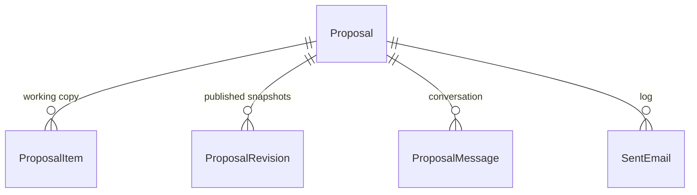

# Spec 001 appendix

Reference material for [spec.md](spec.md). Nothing here changes the contract; it explains, details and proves it.

|                                                                |                                                                                  |
| -------------------------------------------------------------- | -------------------------------------------------------------------------------- |
| [A. Non-goals](#a-non-goals)                                   | [G. Security, accessibility, performance](#g-security-accessibility-performance) |
| [B. Entry kinds](#b-entry-kinds)                               | [H. Acceptance criteria](#h-acceptance-criteria)                                 |
| [C. Data model details](#c-data-model-details)                 | [I. Test plan and traceability](#i-test-plan-and-traceability)                   |
| [D. Edge cases](#d-edge-cases)                                 | [J. Docs to update](#j-docs-to-update)                                           |
| [E. Decisions and alternatives](#e-decisions-and-alternatives) | [K. Rollout and migration](#k-rollout-and-migration)                             |
| [F. Surface behavior details](#f-surface-behavior-details)     | [L. Implementation slices](#l-implementation-slices)                             |

## A. Non-goals

| Not doing                                         | Why                                                                                                                           |
| ------------------------------------------------- | ----------------------------------------------------------------------------------------------------------------------------- |
| Real-time delivery (WebSocket/SSE)                | One process, SQLite, no auth. Polling is enough for a negotiation measured in minutes ([D-4](#e-decisions-and-alternatives)). |
| Unread counters, read receipts, typing indicators | Need per-viewer identity, which the app deliberately lacks.                                                                   |
| Edit or delete messages                           | A negotiation log is evidence. Append-only is simpler and safer.                                                              |
| Attachments, rich text, mentions                  | Plain text covers the need.                                                                                                   |
| Concierge-initiated withdrawal or expiry          | Separate feature ("cancel/expire" in the known gaps).                                                                         |
| Per-item identity across revisions (true diffs)   | Item ids are unstable by design. The change summary is deliberately coarse ([D-5](#e-decisions-and-alternatives)).            |
| Real authentication of authors                    | Out of scope app-wide. Consequences in [G](#g-security-accessibility-performance).                                            |
| Email for every chat message                      | Notifications are out of scope ([OQ-3](spec.md#7-edge-cases-decisions-open-questions)).                                       |

## B. Entry kinds

| `kind`              | Author              | Body                     | Created by                |
| ------------------- | ------------------- | ------------------------ | ------------------------- |
| `chat`              | member or concierge | required                 | `POST /messages`          |
| `changes_requested` | member              | required                 | `POST /request-changes`   |
| `declined`          | member              | required                 | `POST /decline`           |
| `revision_sent`     | concierge           | required (cover message) | `POST /resend`            |
| `sent`              | system              | none                     | `POST /send` (revision 1) |
| `approved`          | system              | none                     | approve transition        |
| `paid`              | system              | none                     | pay transition            |

Transition entries are written in the same transaction as the transition.

## C. Data model details

Follow the `db-change` skill when building.



| Change                         | Notes                                                                                                                                                                                                                                                               |
| ------------------------------ | ------------------------------------------------------------------------------------------------------------------------------------------------------------------------------------------------------------------------------------------------------------------- |
| **`ProposalRevision`**         | `proposalId`, `number`, note, items snapshot (serialized, validated by zod when read), `sentAt`. Unique on `(proposalId, number)`. Total is derived, never stored.                                                                                                  |
| **`ProposalMessage`**          | `proposalId`, `kind`, `authorRole` (`member` / `concierge` / `system`), `authorName`, `body` (null for system entries), `revision` (latest revision when written), `clientId` (nullable, unique per proposal), `createdAt`. Index on `(proposalId, createdAt, id)`. |
| **`Proposal.currentRevision`** | Integer, 0 until first send. Denormalized for the atomic guard ([D-7](#e-decisions-and-alternatives)). Invariant tested.                                                                                                                                            |
| **`Proposal.declinedAt`**      | One-shot timestamp.                                                                                                                                                                                                                                                 |
| **`SentEmail.revision`**       | Which revision each email delivered.                                                                                                                                                                                                                                |
| **`status` values**            | `changes_requested` and `declined`, lowercase strings defined once in `src/lib/schemas/proposal.ts` (no DB enums, per existing decision).                                                                                                                           |

Rules:

- **Repeatable events have no timestamp column.** `sentAt`, `approvedAt`, `paidAt`, `declinedAt` happen at most once. `Proposal.sentAt` keeps meaning "first sent"; each revision carries its own `sentAt`.
- **Working copy equals latest revision** in every status except `draft` and `changes_requested`.
- **Append-only.** No update or delete path for `ProposalRevision` or `ProposalMessage`.
- **Seed (SHOULD).** One demo proposal in `changes_requested` with a short conversation, so a reviewer sees the feature without clicking through the loop.

## D. Edge cases

| #    | Situation                                                               | Expected behavior                                                                                                                |
| ---- | ----------------------------------------------------------------------- | -------------------------------------------------------------------------------------------------------------------------------- |
| E-1  | Member approves while another tab (or a stale page) requests changes    | Exactly one wins by conditional write. The loser gets `INVALID_TRANSITION`, refetches and converges. No orphan entry.            |
| E-2  | Member acts on revision 1 after the concierge resent revision 2         | `STALE_REVISION`, nothing written. The UI shows the banner. Typed text is kept.                                                  |
| E-3  | Two concierge tabs resend at once                                       | One creates revision N+1. The other gets `INVALID_TRANSITION` (status is already `sent`). The unique constraint is the backstop. |
| E-4  | Member declines while the concierge is editing                          | The concierge's next save returns `NOT_EDITABLE`. The builder shows the decline banner with the reason.                          |
| E-5  | A chat message is posted as the status becomes `paid`                   | Either order is valid. If it loses, `CONVERSATION_CLOSED` and the text stays in the composer.                                    |
| E-6  | Resend with zero items                                                  | `EMPTY_PROPOSAL` (422). Full rollback: no revision, no email, no entry.                                                          |
| E-7  | Resend with unchanged content                                           | Allowed. Labeled "No itinerary changes".                                                                                         |
| E-8  | Response lost after a successful chat post, then retry                  | Same `clientId`, so the server returns the existing entry. No duplicate.                                                         |
| E-9  | Member opens the link in `changes_requested` before any concierge reply | Sees the last revision, their own request and "Your concierge is working on it".                                                 |
| E-10 | The revision 1 email is opened after revision 2 exists                  | Same URL, shows the latest revision. Correct by design.                                                                          |
| E-11 | Whitespace-only, empty or 2001-character body                           | `VALIDATION_ERROR`. Nothing written.                                                                                             |
| E-12 | Member posts to a `draft`                                               | `CONVERSATION_CLOSED`. The list endpoint returns empty.                                                                          |
| E-13 | Two entries in the same millisecond                                     | Ordered by id as the tiebreak. Stable across refetches.                                                                          |
| E-14 | Declined proposal, concierge wants to continue                          | Create a new proposal for the reservation. No link between the two conversations (non-goal).                                     |

## E. Decisions and alternatives

Each is a candidate entry for [decisions.md](../../decisions.md).

| ID   | Decision                                                                                                           | Alternatives rejected                                                                                                    | Why                                                                                                                                                                  |
| ---- | ------------------------------------------------------------------------------------------------------------------ | ------------------------------------------------------------------------------------------------------------------------ | -------------------------------------------------------------------------------------------------------------------------------------------------------------------- |
| D-1  | Two member actions: **request changes** (loops) and **decline** (terminal)                                         | One "decline with message" that always loops; changes-only                                                               | The business outcomes differ (negotiate vs. lost deal). One status per outcome keeps reporting honest.                                                               |
| D-2  | **Immutable revisions** under one proposal and one link                                                            | New proposal with `supersedesId` (new link, cluttered list); edit `sent` in place (breaks the approve-what-you-saw rule) | One URL for the member, full history for the concierge, immutability intact.                                                                                         |
| D-3  | Conversation **per proposal**                                                                                      | Per reservation                                                                                                          | Entries relate to a revision and a lifecycle. A per-reservation chat needs cross-proposal rules.                                                                     |
| D-4  | **Polling**                                                                                                        | SSE/WebSocket                                                                                                            | No long-lived-connection infrastructure, no auth to scope a channel. 5 s latency is fine here. Revisit if a real backend appears.                                    |
| D-5  | Revision snapshot stored as **serialized items**, validated on read; the change summary compares full item content | Items table with `revisionId`; true per-item diff                                                                        | Snapshots never change and are never queried by field, so a second items table buys nothing. Item ids are unstable by design, so an edit shows as "removed + added". |
| D-6  | **Dedicated verbs** for transitions with a payload or side effect; `PATCH` stays for payload-less member moves     | Overload `PATCH` with a body per status                                                                                  | Same principle as `sent` only via `/send`: side effects can't be skipped.                                                                                            |
| D-7  | `currentRevision` on `Proposal`; every member write is `updateMany where { id, status, currentRevision }`          | Read the latest revision, then write                                                                                     | One atomic statement, no read-then-write window. The cost is a denormalized counter, guarded by an invariant test.                                                   |
| D-8  | **Member reads the latest revision**, not the working copy                                                         | Member reads the working copy                                                                                            | After a request the concierge edits; the member must not watch a half-edited itinerary.                                                                              |
| D-9  | Repeatable events live in the conversation and revisions; one-shot ones stay as columns                            | A timestamp column per status                                                                                            | `changes_requested` repeats. Columns would silently keep only the last one.                                                                                          |
| D-10 | Resend of **unchanged** content is allowed                                                                         | Reject with `NO_CHANGES`                                                                                                 | Without it the loop dead-ends when the answer is "we can't change that". The concierge explains in the cover message and the member decides.                         |
| D-11 | Request and decline messages are **mandatory**                                                                     | Optional reason                                                                                                          | A decline with no reason teaches the business nothing; a request with no text is meaningless. The friction is the point.                                             |
| D-12 | Chat messages are **optimistic** with `clientId` idempotency                                                       | Pessimistic like other creates                                                                                           | Chat that waits on the network feels broken. The server adds only id and timestamp, so rollback is trivial.                                                          |

## F. Surface behavior details

### Member

- **Request changes and Decline share one sheet**, with a mandatory message and a different heading and button. Decline asks for explicit confirmation; one tap must not end a deal.
- **The conversation** opens as a bottom sheet on mobile and a side panel on wide screens. Concierge entries show the signature; the member's own entries show "You". Until a concierge entry exists the concierge is "Your concierge".
- **`declined`** shows a quiet closing page with the date and a read-only conversation. It reveals nothing beyond what the member already saw.
- **Stale protection.** A poll that finds a newer revision shows "A new version is ready" and disables actions until the member opens it. A rejected action never clears the member's typed text.

### Concierge

- **Reply & resend dialog:** cover message (required), signature (required, prefilled from the last one used, kept in browser-local storage as a convenience, never as source of truth) and the change summary against the previous revision. An unchanged itinerary is labeled as such.
- **Conversation tab** beside the builder; the composer has a signature field.
- **Revisions list:** each revision with date, summary and a read-only view.
- **Preview parity:** the concierge preview keeps rendering what the member sees, now the latest revision for sent proposals.

### Optimistic updates

Extends [proposal-lifecycle.md](../../proposal-lifecycle.md), which today limits optimism to send, approve and pay.

| Operation                        | Optimistic                                                                   | Rendered from the server response                                              |
| -------------------------------- | ---------------------------------------------------------------------------- | ------------------------------------------------------------------------------ |
| Request changes, decline, resend | Status badge only                                                            | The new conversation entry, the success state, and for resend the new revision |
| Chat message                     | Appears immediately as _pending_ with its `clientId`, reconciled on response | Final id and timestamp                                                         |
| Chat failure                     | Marked _failed_ with **Retry**, which reuses the same `clientId`             |                                                                                |

Rollback, refetch on `INVALID_TRANSITION` and `STALE_REVISION`, and invalidate-on-settle work as in the lifecycle doc. Chat is the one create operation allowed to be optimistic, because the server adds only an id and a timestamp to what the user typed.

### Polling

- Poll the conversation (and, for the member, the latest revision number) every **5 s** while the tab is visible and the conversation is open.
- Pause when hidden, refetch on focus, back off to 30 s after repeated errors, stop when the conversation closes.
- Built on TanStack Query's refetch interval. No `useEffect` is needed.

## G. Security, accessibility, performance

### Security and abuse

The app has no authentication; the unguessable proposal id is the member's access. This feature inherits that and says so plainly.

- **Spoofing is possible and accepted.** Anyone with a member link can post as that member; anyone who opens the dashboard can post as concierge. Production needs real auth, signed expiring links and a server-derived role. The signature is a display label, and the UI must not present it as verified.
- **The member's name is never client-supplied** ([FR-11](spec.md#2-requirements)). The concierge's is, because no concierge identity exists.
- **XSS:** plain text, escaped on render. No HTML or Markdown rendering, no link auto-embedding.
- **Abuse limits:** 2000 characters per entry, 500 entries per conversation (a full conversation behaves as closed). Rate limiting is out of scope.
- **Information leak:** a draft's conversation returns an empty list and the member page keeps its "not available" behavior.

### Accessibility

- The entry list is `role="log"` with polite live updates; the new-version banner is `role="status"`.
- Sheets and dialogs trap focus, close on Esc and return focus to their trigger.
- The composer has a visible label. Enter inserts a newline; Cmd/Ctrl+Enter or the button sends.
- Motion respects `prefers-reduced-motion`. Text contrast at least AA. Touch targets at least 44 px.

### Performance

- A full conversation (500 plain-text entries) is small enough to refetch whole. Incremental sync would add cursor logic for no measurable gain.
- No polling while hidden or closed, so idle tabs cost nothing.

## H. Acceptance criteria

```gherkin
AC-1  Given a sent proposal at revision 1
      When the member requests changes with "Move the spa to Tuesday"
      Then the status is changes_requested
      And the conversation ends with a changes_requested entry from the member containing that text

AC-2  Given a proposal in changes_requested and the concierge has edited the working copy
      When the member loads the proposal
      Then the member sees revision 1, not the edited items

AC-3  Given the member is viewing revision 1 and the concierge has resent revision 2
      When the member approves with revision 1
      Then the response is 409 STALE_REVISION and the status is unchanged

AC-4  Given a proposal in changes_requested with at least one item
      When the concierge resends with a cover message and a signature
      Then revision 2 exists, the status is sent, a SentEmail for revision 2 exists
      And a revision_sent entry with the signature is appended

AC-5  Given a proposal in changes_requested with no items
      When the concierge resends
      Then the response is 422 EMPTY_PROPOSAL and no revision, email or entry exists

AC-6  Given a resend whose items equal revision 1
      Then it succeeds and the change summary reports "no changes"

AC-7  Given revision 2 differs from revision 1 by one added item
      Then the summary lists that item as added and shows the total difference

AC-8  Given a paid or declined proposal
      When anyone posts a message
      Then the response is 409 CONVERSATION_CLOSED and the conversation is unchanged

AC-9  Given a chat message was posted with clientId X
      When the same request is repeated
      Then no second entry exists and the original entry is returned

AC-10 Given two simultaneous resend requests
      Then exactly one succeeds and the revision numbers are unique and contiguous

AC-11 Given the member is on revision 1 and revision 2 arrives by polling
      Then a banner appears and Approve stays disabled until the member opens revision 2

AC-12 Given existing proposals sent, approved and paid before this feature
      When the migration runs
      Then each has revision 1 equal to its items, currentRevision 1 and matching events
```

## I. Test plan and traceability

Levels: **U** unit (pure code), **A** API (real route handlers against the throwaway SQLite, asserting responses and rows), **H** hook or component.

| Requirement            | Acceptance criteria | Level | Test focus                                                                                                                                 |
| ---------------------- | ------------------- | ----- | ------------------------------------------------------------------------------------------------------------------------------------------ |
| FR-1, FR-2, FR-3, FR-6 | AC-1 to AC-5        | U     | **Every (from, to) pair** of the 6 statuses asserted legal or illegal. Extends `state-machine.test.ts`.                                    |
| FR-3                   | AC-4, AC-6          | A     | `PUT` allowed in `changes_requested`, `NOT_EDITABLE` elsewhere; unchanged resend succeeds.                                                 |
| FR-4, FR-5             | AC-2, AC-4          | A     | One revision per send. The member endpoint returns the latest revision even while the working copy differs.                                |
| FR-6                   | AC-3                | A     | `STALE_REVISION` on every member action with **no row changes**. Check order against `INVALID_TRANSITION`.                                 |
| FR-7                   | AC-7                | U     | Change-summary function: added, removed, total difference, unchanged, edited item as removed + added.                                      |
| FR-8 to FR-11          | AC-8                | U, A  | Body validation (empty, whitespace, 2001 chars), open/closed per status, `CONVERSATION_CLOSED`, ordering, member name derived server-side. |
| FR-12                  | AC-9                | A     | Repeated `clientId` returns the existing entry and writes no second row.                                                                   |
| E-1                    | AC-3                | A     | **Concurrent** approve vs. request-changes: one 200, one 409, one entry. Extends the existing concurrent-approve test.                     |
| E-3                    | AC-10               | A     | Concurrent resend: one revision created, no duplicate number.                                                                              |
| E-6                    | AC-5                | A     | Resend with zero items leaves no revision, email or entry.                                                                                 |
| Invariants             | all                 | A     | `currentRevision` equals the highest revision number; working copy equals latest revision outside the editable statuses.                   |
| FR-13, FR-14, FR-17    | AC-11               | H     | Optimistic chat reconciles and recovers on failure; actions are disabled while a newer revision is pending.                                |
| Migration              | AC-12               | A     | Backfill produces revision 1 and matching entries for existing non-draft proposals.                                                        |

## J. Docs to update

Per `AGENTS.md`, behavior changes update the matching doc in the same change.

| Doc                     | Update                                                                                                                               |
| ----------------------- | ------------------------------------------------------------------------------------------------------------------------------------ |
| `proposal-lifecycle.md` | Six statuses, the edge table, editable statuses, the revision guard, the widened optimistic rule                                     |
| `data-model.md`         | New entities, the working-copy vs. revision rule, the repeatable-event rule                                                          |
| `api.md`                | New routes, the changed `PATCH` and `PUT` rules, new error codes and check order                                                     |
| `design.md`             | Member bar and sheets, conversation panel, the concierge's signature replacing "Your concierge"                                      |
| `product.md`            | "Proposal versioning" leaves out-of-scope. "Cancellation" is partly delivered (decline); expiry stays out. Add the new capabilities. |
| `decisions.md`          | D-1 to D-12                                                                                                                          |

## K. Rollout and migration

One migration, no feature flag (single process, no external consumers).

1. Create `ProposalRevision` and `ProposalMessage`. Add `Proposal.currentRevision` (default 0), `Proposal.declinedAt`, `SentEmail.revision`.
2. **Backfill** every proposal that is not a `draft`: revision 1 from the current note and items, `currentRevision = 1`, and entries for `sent` (at `sentAt`) plus `approved` and `paid` where their timestamps exist. Set `SentEmail.revision = 1`.
3. Deploy code that reads the member page from revisions.

The old `PATCH` body had no `revision`, so the member client and the route ship together. Rollback is a code revert: the new tables and columns are additive and harmless to the old code.

## L. Implementation slices

Each slice leaves `npm run check` green and is shippable alone. A `plan.md` would expand them with files and tasks.

1. Schema, migration, backfill, seed.
2. State machine as an edge list, with the exhaustive pair test.
3. Revisions on send; the member page reads the latest revision.
4. Revision guard on `PATCH` (`STALE_REVISION`).
5. Request changes and decline.
6. Conversation read and post, with idempotency and the closed rule.
7. Resend, email and change summary.
8. Member UI: sheets, banner, polling.
9. Concierge UI: conversation tab, pinned request, resend dialog, revisions list.
