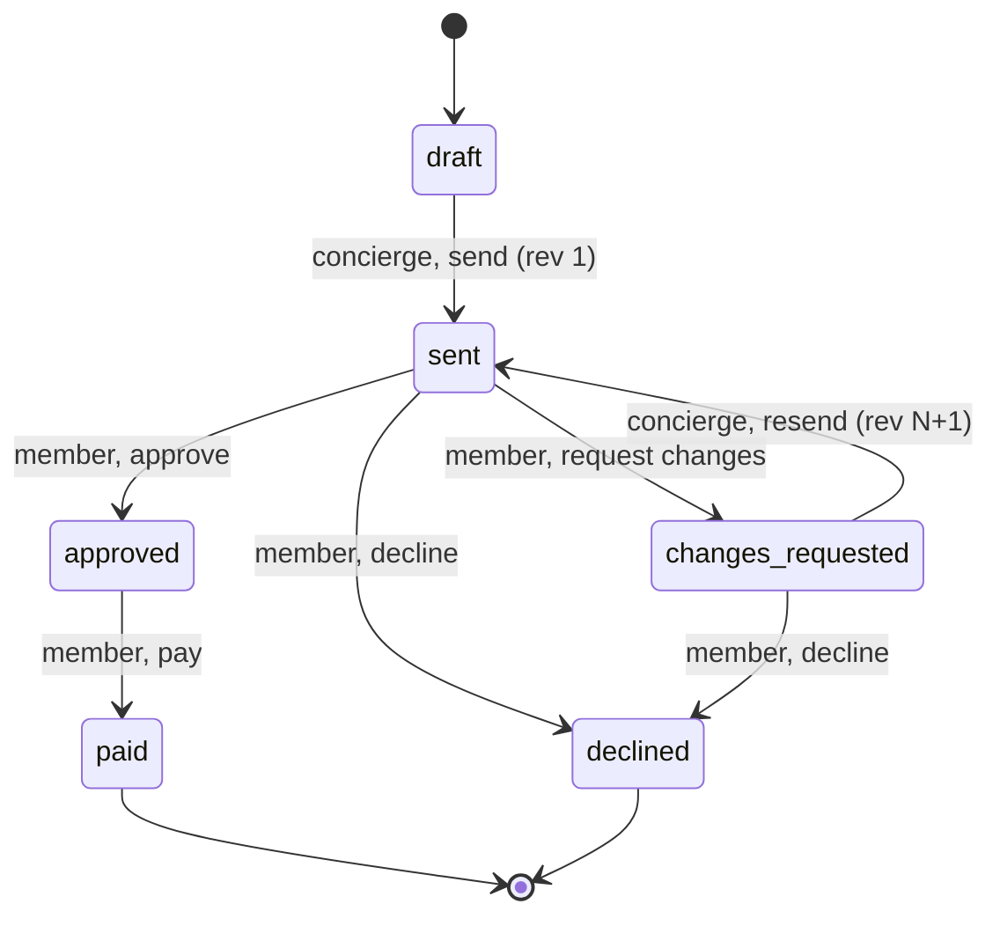
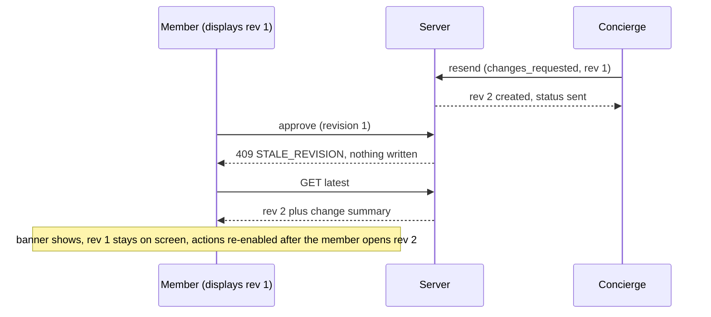

# Spec 001: Revision requests and proposal conversation

|                    |                                                                                                                                                                                                                                                                                                                                                     |
| ------------------ | --------------------------------------------------------------------------------------------------------------------------------------------------------------------------------------------------------------------------------------------------------------------------------------------------------------------------------------------------- |
| **Status**         | Draft for review; the defaults in [section 7](#7-highlights-from-the-appendix) await confirmation                                                                                                                                                                                                                                                   |
| **Author**         | Bohdan Kopcha                                                                                                                                                                                                                                                                                                                                       |
| **Date**           | 2026-11-24                                                                                                                                                                                                                                                                                                                                          |
| **Implementation** | None yet. This is the behavioral contract; exact schemas become zod schemas in `src/lib/schemas/` when built, and field-level payload shapes are in [appendix M](appendix.md#m-api-payloads). Each implementation slice updates the docs it changes in the same change ([appendix J](appendix.md#j-docs-to-update)); this file stays as the record. |
| **How to read**    | **Today** and **At a glance**: 3 minutes. **Sections 1–7**: about 15 minutes. [**Appendix**](appendix.md): reference (all edge cases, all decisions, payloads, acceptance tests, traceability, migration), read only what you need.                                                                                                                 |

---

## Today (what already exists)

**Detour** is a small tool for a resort-travel concierge team. A **concierge** builds a **proposal** (a day-by-day itinerary with prices) for a **member's reservation** (one stay), sends it, and the member approves and "pays" to lock it in. Background: [product.md](../../product.md), [proposal-lifecycle.md](../../proposal-lifecycle.md), [api.md](../../api.md), [data-model.md](../../data-model.md).

- **Statuses:** `draft` → `sent` → `approved` → `paid`. Only a `draft` is editable; from `sent` on, the member approves exactly what they saw.
- **Existing errors**, all in the shared format of [api.md](../../api.md): `VALIDATION_ERROR` (400), `NOT_FOUND` (404), `INVALID_TRANSITION` (409), `NOT_EDITABLE` (409), `EMPTY_PROPOSAL` (422). Repeating the current status is an error, not a no-op.
- **No authentication.** The concierge dashboard is open; the unguessable proposal id in the member's link is their access.
- **Concurrency pattern already in use:** every status change is a conditional write (`where status = from`), and "send" writes its status first inside a transaction ([decisions.md](../../decisions.md)).

This spec extends all of the above and changes nothing it does not name.

## At a glance

**Problem.** A member can only say yes. A `sent` proposal is approved and paid, or it sits there. Real concierge work is a negotiation: move the spa to Tuesday, drop the excursion, ask about a dietary need.

**Feature.** Turn the one-way flow into a loop with a paper trail:

- The member can **request changes** or **decline**, always with a message.
- The concierge edits and **resends** a numbered **revision** with a cover message and a signature.
- Every sent proposal gets a **conversation**: messages from both sides and the proposal's own events in one chronological stream, shown in a chat-style window to both.

The central idea: **a revision is what the member approves; the conversation is the history of how it got there.** Both are append-only, so "the member approves exactly what they saw" survives the new flow (within the app's no-authentication trust model, see [appendix G](appendix.md#g-security-accessibility-performance)).

**Six things worth a look** (the non-obvious parts):

1. **Stale-revision guard.** A member who is looking at revision 1 can't approve after the concierge sent revision 2. Every member action says which revision it refers to; if that is not the latest, the server answers `409 STALE_REVISION` and saves nothing.
2. **The member only ever sees sent revisions, never the concierge's unsent edits.** One response carries status and itinerary together, so they can't come from two different moments.
3. **Race-safe writes.** Every write that depends on a status begins with one conditional update, so nothing can slip in between a check and a write ([section 5](#5-api)).
4. **Every status change records its conversation entry in the same transaction.** Those entries don't count toward the chat limit, so a flooded chat can never block a deal.
5. **The transition table can branch.** Today it maps one status to one next status. It becomes a list of edges, and UI buttons are still derived from it, now per actor.
6. **Resending unchanged content is allowed.** Otherwise the loop dead-ends on "we can't change that".

**Scope.** **P1** is the minimum coherent feature: request changes, decline, revisions, resend, the change summary, the conversation with chat posting, and the member's "new version" banner (driven by refetch). **P2** completes it: polling, optimistic chat with idempotency, revision browsing. Not doing: real-time delivery, unread counters, message edit/delete, real authentication ([appendix A](appendix.md#a-non-goals)).

---

## 1. Scenarios and terms

| ID   | As a      | I want to                                                     | So that                                                | Pri |
| ---- | --------- | ------------------------------------------------------------- | ------------------------------------------------------ | --- |
| US-1 | member    | ask for changes, or decline, with a note                      | the itinerary fits what I want, or I can leave cleanly | P1  |
| US-2 | concierge | see the request next to the itinerary and resend with my name | the member knows what changed and who answered         | P1  |
| US-3 | member    | be protected from approving a version I haven't seen          | I never pay for a surprise                             | P1  |
| US-4 | both      | exchange short messages                                       | small questions don't need a new revision              | P1  |
| US-5 | concierge | open any earlier revision                                     | I can answer "what did I offer last time?"             | P2  |

**Terms** (used exactly this way everywhere):

| Term                   | Meaning                                                                                                                                                                                                                                     |
| ---------------------- | ------------------------------------------------------------------------------------------------------------------------------------------------------------------------------------------------------------------------------------------- |
| **Working copy**       | The note and items stored on the proposal. The only thing the concierge edits.                                                                                                                                                              |
| **Revision**           | An immutable snapshot of note and items taken at every send, numbered from 1, carrying that send's cover message and signature. The member sees revisions, never the working copy.                                                          |
| **Latest revision**    | The highest-numbered revision. `currentRevision` on the proposal points at it.                                                                                                                                                              |
| **Conversation**       | A sent proposal's ordered, append-only list of entries.                                                                                                                                                                                     |
| **Entry**              | One row of the conversation. Two groups: a **chat entry** (free message from either side) and a **transition entry** (written together with a status change: `sent`, `approved`, `paid`, `changes_requested`, `declined`, `revision_sent`). |
| **Signature**          | The display name a concierge types on a resend or a chat message. Stored as typed after trimming; not verified.                                                                                                                             |
| **Displayed revision** | The revision the member's screen is currently showing, which can lag behind the latest revision.                                                                                                                                            |
| **Revision view**      | The single response of `GET …/revisions/[revision]`: the proposal's status fields plus one revision, read in one transaction ([appendix M](appendix.md#m-api-payloads)).                                                                    |

Entry kinds in detail: [appendix B](appendix.md#b-entry-kinds).

## 2. Requirements

Keywords follow RFC 2119. Every requirement and edge case is traced to a test in [appendix I](appendix.md#i-test-plan-and-traceability).

| ID    | Requirement                                                                                                                                                                                                                                                                                                                                                                                                                                                                                                                                                                                                                                                      | Pri |
| ----- | ---------------------------------------------------------------------------------------------------------------------------------------------------------------------------------------------------------------------------------------------------------------------------------------------------------------------------------------------------------------------------------------------------------------------------------------------------------------------------------------------------------------------------------------------------------------------------------------------------------------------------------------------------------------- | --- |
| FR-1  | A member MUST be able to request changes on a `sent` proposal with a message (1–2000 UTF-16 code units after trim, see FR-10). Status becomes `changes_requested`.                                                                                                                                                                                                                                                                                                                                                                                                                                                                                               | P1  |
| FR-2  | A member MUST be able to decline a `sent` or `changes_requested` proposal with a message (same limits). Status becomes `declined`, terminal.                                                                                                                                                                                                                                                                                                                                                                                                                                                                                                                     | P1  |
| FR-3  | In `changes_requested` the concierge MUST be able to edit note and items (same validation as a draft) and resend with the `revision` it is replying to, a `coverMessage` (1–2000) and a `signature` (1–60), at least one item. The UI saves the working copy first ([section 6](#6-behavior-by-surface)). One transaction creates revision N+1 (storing cover message and signature on it), sets `sent`, writes the sent-email record and appends the entry; the email is logged to the console after commit, as `send` does today. A resend whose `revision` is not exactly the latest is `STALE_REVISION`, like a member action. Unchanged content is allowed. | P1  |
| FR-4  | Every send MUST create an immutable revision. No domain function updates or deletes a revision or an entry; only creation exists.                                                                                                                                                                                                                                                                                                                                                                                                                                                                                                                                | P1  |
| FR-5  | The member page MUST read one consistent response (the **revision view**: status, revision number, snapshot, cover message, signature, change summary) from `GET …/revisions/latest`, read in one transaction. Member actions (`PATCH`, request changes, decline) also respond with a revision view. The member client never receives the working copy.                                                                                                                                                                                                                                                                                                          | P1  |
| FR-6  | Every member transition (approve, pay, request changes, decline) MUST carry the displayed revision. If the status is a legal source but the revision is not exactly the latest (older or newer), reject with `STALE_REVISION` and write nothing. If the status is not a legal source the answer is `INVALID_TRANSITION` first ([section 5](#5-api)).                                                                                                                                                                                                                                                                                                             | P1  |
| FR-7  | A change summary against the previous revision MUST come from one pure function: items added and removed (compared as a multiset on full item content, order ignored), the signed total difference, and whether the note changed. Labels: "No itinerary changes" when nothing was added or removed, plus "Note updated" when the note differs.                                                                                                                                                                                                                                                                                                                   | P1  |
| FR-8  | A sent proposal MUST have a conversation: its entries (chat and transition) ordered by `(createdAt, id)`, immutable. A live entry's `createdAt` is assigned inside its transaction, after the guard write, and is strictly later than the proposal's previous newest entry, so live entries never tie and never go backwards. A draft has none: its conversation and revision endpoints return `404`, the same as an unknown id.                                                                                                                                                                                                                                 | P1  |
| FR-9  | Member and concierge MUST be able to post chat entries while the conversation is open (`sent`, `changes_requested`, `approved`); it is read-only in `paid` and `declined`. One pure function, `canPostChat(status, chatEntryCount)`, returns `ok`, `closed` or `full` and is shared by server and UI. `closed` is reported before `full`, and a draft is `closed` (though the routes answer `404` first).                                                                                                                                                                                                                                                        | P1  |
| FR-10 | Every text input (body, cover message, signature, author name) MUST be trimmed, then validated and stored trimmed: bodies and cover messages 1–2000 UTF-16 code units (as zod counts them), signatures and author names 1–60. Text is rendered as plain text (escaped, line breaks preserved, never HTML or Markdown). A conversation holds at most 500 **chat** entries; transition entries are exempt, so a full conversation never blocks a status change.                                                                                                                                                                                                    | P1  |
| FR-11 | A concierge entry MUST store its signature as typed (after trimming). The member's own entries (`chat`, `changes_requested`, `declined`) MUST take the member's name from the database, never from the request. The `sent`, `approved` and `paid` entries are system entries named "System".                                                                                                                                                                                                                                                                                                                                                                     | P1  |
| FR-12 | Posting a chat entry MUST be idempotent per client-generated `clientId` (1–64 characters). A replay with an identical payload returns the existing entry, even if the conversation has since closed. A replay differing in author role, author name or body is `IDEMPOTENCY_CONFLICT`, including when the two requests are concurrent. In P1 the field is accepted and ignored.                                                                                                                                                                                                                                                                                  | P2  |
| FR-13 | While polling is healthy (5 s interval, visible tab), these MUST refresh within 10 s: for the member, the conversation and the latest revision; for the concierge, the open conversation, the open proposal and the proposals list. After repeated errors polling backs off to 30 s. P1 baseline: refetch on mount and window focus.                                                                                                                                                                                                                                                                                                                             | P2  |
| FR-14 | Member page: a conversation sheet, **Request changes** and **Decline**, a change summary on revisions 2 and later, and the "new version" banner, behaving as specified in [section 6](#6-behavior-by-surface).                                                                                                                                                                                                                                                                                                                                                                                                                                                   | P1  |
| FR-15 | Concierge dashboard: a Conversation tab, the member's pending request pinned above the builder (the latest request plus the member's chat entries after it), a **Reply & resend** dialog, and a list with the new statuses, revision number and last activity.                                                                                                                                                                                                                                                                                                                                                                                                   | P1  |
| FR-16 | The resend email preview MUST contain what the `send` email contains today (greeting, destination and dates, item count, total, the note if present, the absolute proposal link) plus the revision number, the cover message and the signature.                                                                                                                                                                                                                                                                                                                                                                                                                  | P1  |
| FR-17 | Chat is optimistic: a message appears immediately as pending and reconciles on the response ([appendix F](appendix.md#f-surface-behavior-details)). Until then (P1) it is shown after the response.                                                                                                                                                                                                                                                                                                                                                                                                                                                              | P2  |
| FR-18 | The concierge MUST be able to open any revision read-only (revision list and single revision).                                                                                                                                                                                                                                                                                                                                                                                                                                                                                                                                                                   | P2  |
| FR-19 | Edits and resends MUST be race-safe: `PUT` and `resend` each begin with their conditional status write, then touch items in the same transaction. A concurrent resend can never leave the working copy different from the latest revision in `sent`.                                                                                                                                                                                                                                                                                                                                                                                                             | P1  |
| FR-20 | Request changes, decline and resend MUST update the status badge optimistically and roll back on failure, as send, approve and pay do today. Their conversation entry and success state come from the server (the refetched conversation or the response), and the member's decline closing page appears only after the server confirms.                                                                                                                                                                                                                                                                                                                         | P1  |

## 3. State machine

| #   | From → To                        | Actor     | Via                      | Preconditions                                                   | Side effects (one transaction)                                                                          |
| --- | -------------------------------- | --------- | ------------------------ | --------------------------------------------------------------- | ------------------------------------------------------------------------------------------------------- |
| T1  | `draft` → `sent`                 | Concierge | `POST …/send`            | ≥ 1 item                                                        | Revision 1, `currentRevision = 1`, `sentAt`, `SentEmail`, `sent` entry                                  |
| T2  | `sent` → `approved`              | Member    | `PATCH …`                | `revision` is the latest                                        | `approvedAt`, `approved` entry                                                                          |
| T3  | `sent` → `changes_requested`     | Member    | `POST …/request-changes` | `revision` is the latest, message                               | `changes_requested` entry                                                                               |
| T4  | `sent` → `declined`              | Member    | `POST …/decline`         | `revision` is the latest, message                               | `declinedAt`, `declined` entry, working copy reset to the latest revision (a no-op when they are equal) |
| T5  | `changes_requested` → `sent`     | Concierge | `POST …/resend`          | `revision` is the latest, ≥ 1 item, `coverMessage`, `signature` | Revision N+1 with cover message and signature, `currentRevision`, `SentEmail`, `revision_sent` entry    |
| T6  | `changes_requested` → `declined` | Member    | `POST …/decline`         | `revision` is the latest, message                               | as T4 (the reset discards unsent edits, [section 4](#4-data-model))                                     |
| T7  | `approved` → `paid`              | Member    | `PATCH …`                | `revision` is the latest                                        | `paidAt`, `paid` entry                                                                                  |

Everything else is illegal, including repeating the current status (`409 INVALID_TRANSITION`, as today). The server does not check _who_ calls an endpoint: the actor column drives which buttons each UI shows ([appendix G](appendix.md#g-security-accessibility-performance)).

| Status              | Editable               | Visible to member | Conversation | Terminal |
| ------------------- | ---------------------- | ----------------- | ------------ | -------- |
| `draft`             | yes                    | no                | none         | no       |
| `sent`              | no                     | latest revision   | open         | no       |
| `changes_requested` | **yes** (working copy) | latest revision   | open         | no       |
| `approved`          | no                     | latest revision   | open         | no       |
| `paid`              | no                     | latest revision   | read-only    | **yes**  |
| `declined`          | no                     | latest revision   | read-only    | **yes**  |

**Code model.** `TRANSITIONS` (today a map from one status to its single successor) becomes a list of edges `{ from, to, actor, verb }`. `canTransition`, `isEditable` (now `draft` and `changes_requested`) and each surface's buttons derive from it. `PATCH` keeps only the message-less member edges (approve, pay); the rest get dedicated verbs, for the same reason `sent` is reachable only through `/send`: an action with a payload or side effect must not be skippable.

**The race the design must win:**

## 4. Data model

Conceptual; exact columns live in `prisma/schema.prisma` once built ([details: appendix C](appendix.md#c-data-model-details)).

| Change                     | Purpose                                                                                                                                                            |
| -------------------------- | ------------------------------------------------------------------------------------------------------------------------------------------------------------------ |
| New `ProposalRevision`     | Immutable snapshot per send: note, items, schema version, and the send's cover message and signature (both null for revision 1). Unique on `(proposalId, number)`. |
| New `ProposalMessage`      | One entry: kind, author role and name, body, `revision`, optional `clientId`.                                                                                      |
| `Proposal.currentRevision` | Denormalized on purpose: it lets the stale guard be one conditional update. Invariant: equals the highest revision number.                                         |
| `Proposal.declinedAt`      | One-shot timestamp, like `approvedAt` and `paidAt`.                                                                                                                |
| `SentEmail.revision`       | Which revision each email delivered.                                                                                                                               |

Two rules:

- **Repeatable events** (changes requested) live in the conversation, because a timestamp column would silently keep only the last one.
- **Working copy vs. revision.** In every status except `draft` and `changes_requested` the working copy equals the latest revision, asserted by a test after every transition. When a member declines from `changes_requested`, the same transaction resets the working copy to the latest revision, discarding the concierge's unsent edits. They were never shown to the member and the proposal is terminal, and one truth for the API, the list totals and the UI is worth more than keeping them ([D-14](appendix.md#e-decisions-and-alternatives)).

## 5. API

Intent here; field-level payloads in [appendix M](appendix.md#m-api-payloads).

| Method and path                                | Purpose                                                                                                                                             | Pri |
| ---------------------------------------------- | --------------------------------------------------------------------------------------------------------------------------------------------------- | --- |
| `GET /api/proposals/[id]/messages`             | The conversation, oldest first                                                                                                                      | P1  |
| `POST /api/proposals/[id]/messages`            | Post a chat entry. `author: concierge` requires `authorName` (1–60); `author: member` forbids it. Optional `clientId` (accepted and ignored in P1). | P1  |
| `POST /api/proposals/[id]/request-changes`     | T3. Body: `revision`, `body`                                                                                                                        | P1  |
| `POST /api/proposals/[id]/decline`             | T4, T6. Body: `revision`, `body`                                                                                                                    | P1  |
| `POST /api/proposals/[id]/resend`              | T5. Body: `revision` (the revision being replied to), `coverMessage`, `signature`                                                                   | P1  |
| `GET /api/proposals/[id]/revisions/[revision]` | The revision view of one revision. `revision` is a positive integer or `latest`. The member page reads `latest`.                                    | P1  |
| `GET /api/proposals/[id]/revisions`            | Revision list with change summaries                                                                                                                 | P2  |

**Unknown or draft.** For an unknown id, and also for a draft, every route in the table above returns `404 NOT_FOUND`, so these new endpoints reveal nothing about a draft ([D-18](appendix.md#e-decisions-and-alternatives)). `PATCH`, `PUT` and `/send` keep today's behavior for drafts. A revision segment that is neither a positive integer nor `latest` is `400`; a well-formed number with no such revision is `404`.

**Changes to existing routes**

- `PATCH` gains a required `revision` and responds with a revision view. Its status enum widens to all six values; the domain rejects any target that is not a member `PATCH` edge with `409 INVALID_TRANSITION`, as it rejects `sent` today. An unknown status value, or a missing or invalid `revision`, is `400`. Unknown fields keep today's handling.
- `PUT` is allowed in `draft` and `changes_requested`, keeping today's check order (see guard 2).
- `GET /api/proposals/[id]` and the summaries gain `currentRevision` and `lastActivityAt`. `lastActivityAt` is the proposal's `updatedAt` for a draft and the newest entry's `createdAt` for anything sent (every transition writes an entry, so it is never null once sent).
- `GET /api/proposals/[id]` remains the concierge's working-copy endpoint. The member page must not use it. With no authentication this is enforced by tests, not by access control ([appendix G](appendix.md#g-security-accessibility-performance)).

**New error codes**

| HTTP | Code                   | When                                                                                                                                          |
| ---- | ---------------------- | --------------------------------------------------------------------------------------------------------------------------------------------- |
| 409  | `STALE_REVISION`       | A member action's or a resend's revision is not exactly the latest. The `message` names both numbers; the UI refetches instead of parsing it. |
| 409  | `CONVERSATION_CLOSED`  | Chat posted to a `paid` or `declined` proposal.                                                                                               |
| 409  | `CONVERSATION_FULL`    | Chat posted when 500 chat entries exist.                                                                                                      |
| 409  | `IDEMPOTENCY_CONFLICT` | A `clientId` is replayed with a different author role, author name or body.                                                                   |

**Guards.** Each of these begins with one conditional write. The app runs one SQLite connection in one process (better-sqlite3) and its adapter runs transactions one at a time, so writers queue; a busy timeout is configured as a safety net, and tests expect clean `409`s, never `500`s. Guards 1 to 3 stay correct even without that serialization, because each is a single conditional statement and `resend` does its first write before reading anything. Guard 4 is the one that relies on the write lock: it counts chat entries after its guard write, which keeps the 500 cap exact.

1. **Member transitions (T2–T4, T6, T7):** `updateMany where { id, status: from, currentRevision: displayed }`; decline uses `status in (sent, changes_requested)`. If it changes one row, the entry and side effects are written in the same transaction. A decline always resets the working copy to the latest revision (a no-op when they are already equal), so no read is needed to tell T4 from T6.
2. **`PUT`:** today's order from [api.md](../../api.md) is kept (unknown id `404`, then `NOT_EDITABLE`, then item validation). After the request body passes schema validation (`400`), first `updateMany where { id, status in (draft, changes_requested) }` (touching the row); zero rows means `NOT_EDITABLE`. Then validate the items against the trip window (`400`, rolling the transaction back) and replace them.
3. **`resend` (T5):** first `updateMany where { id, status: changes_requested, currentRevision: revision }` that sets `sent` and increments `currentRevision`. Then, in the same transaction, read the saved items, write the revision (with cover message and signature), the email record and the entry. No items: roll back with `EMPTY_PROPOSAL`. Zero rows: classified below.
4. **Chat post:** first `updateMany where { id, status in (sent, changes_requested, approved) }` that sets `updatedAt`, so it really writes and takes the write lock; then count chat entries (500 or more: roll back with `CONVERSATION_FULL`) and insert.

**Error classification.** When a guard changes zero rows the server re-reads, inside the same transaction and **only to choose the error**, in this order: unknown id, or a draft on one of the new routes (`404`); status not a legal source (`INVALID_TRANSITION` for transitions and resend, `NOT_EDITABLE` for `PUT`, `CONVERSATION_CLOSED` for chat); then revision not exactly the latest (`STALE_REVISION`, for member actions and resend). The re-read never decides whether to write, so it adds no race. Schema validation of the request (`400`) runs before everything. Status is the more fundamental truth, so it is reported first.

**Chat order:** schema validation (`400`); unknown id or draft (`404`); `clientId` replay lookup (an identical payload returns the existing entry with `200`, a different one is `IDEMPOTENCY_CONFLICT`); then guard 4. If the insert hits the unique `(proposalId, clientId)` index because of a concurrent duplicate, re-read the winner and apply the same rule: an identical payload gets `200` with the winner's entry, a different payload gets `IDEMPOTENCY_CONFLICT`. This is active from P2; in P1 `clientId` is accepted and ignored.

## 6. Behavior by surface

Visual language follows [design.md](../../design.md): quiet and premium for the member, fast and dense for the concierge.

**Member (`/proposal/[id]`)**

| Status               | What the member sees                                                                                                                                                                                                                               | Actions                                                   |
| -------------------- | -------------------------------------------------------------------------------------------------------------------------------------------------------------------------------------------------------------------------------------------------- | --------------------------------------------------------- |
| `sent`, revision 1   | Itinerary as on the member page today                                                                                                                                                                                                              | **Approve**, **Request changes**, Decline (menu), Message |
| `sent`, revision ≥ 2 | Cover message and signature above the itinerary, a collapsible "What changed", a "Revision N" pill                                                                                                                                                 | Same                                                      |
| `changes_requested`  | Last revision, read-only, "Changes requested" pill, "{Name} is working on your request". The name is the latest concierge entry's signature (any kind, [D-17](appendix.md#e-decisions-and-alternatives)); until one exists it is "Your concierge". | Message, Decline                                          |
| `approved`           | The trip pass as on the member page today                                                                                                                                                                                                          | **Pay & Lock In**, Message                                |
| `paid` / `declined`  | The confirmation screen as today / a quiet closing page. Both offer "View conversation", which opens the conversation read-only.                                                                                                                   | View conversation                                         |

- Request changes and Decline share one sheet with a mandatory message. Decline asks for explicit confirmation.
- **Displayed vs. latest (the one place this rule is written).** The member page reads `GET …/revisions/latest`. The client keeps the `revision` part of the response that is on screen as the **displayed revision**; the `proposal` part (status and so on) always updates. When a later response carries a higher revision number (learned by refetch on focus, by a `STALE_REVISION` response, or by polling in P2), the displayed revision does not change: the "new version" banner appears, and **Approve, Pay, Request changes and Decline stay disabled until the member opens the new revision**, which adopts the new response's `revision` part. Chat stays available. Every action sends the displayed revision number. The server guard is the backstop, not the plan.
- **Typed text is kept, never auto-sent.** A rejected action never clears the member's text. After the member opens the newer revision, a half-written request or decline stays in the sheet, marked "written for revision N", and needs a fresh tap to send.

**Concierge (`/planning/[id]`)**

- The list keeps its current order: newest first by creation date (`createdAt`), so a chat post touching `updatedAt` never reorders it. Sent proposals show `Rev N` (a draft shows none) and last activity, and `changes_requested` rows carry a "needs you" accent. **Known P1 limitation:** until polling (P2), the list refreshes only on mount and window focus, so a tab left focused and untouched won't show a new request.
- In `changes_requested` the builder is editable with the member's **pending request** pinned above it: the latest request plus everything the member wrote after it. The primary action is **Reply & resend** (revision being replied to, cover message, signature, change summary). **Reply & resend saves first:** if the builder has unsaved edits the UI saves them with `PUT`, then resends, so the revision never differs from what the builder shows. If the save fails nothing is resent and the error is shown; if the save succeeds and the resend fails the saved edits remain and the dialog offers a retry.
- **Preview** renders the working copy in `draft` and `changes_requested` (what the member will see after sending) and the latest revision otherwise.
- **Known P1 limitations (chat):** until `clientId` idempotency (P2), a chat message whose response is lost and which the user sends again appears twice. A member's chat question in `sent` or `approved` raises no accent in the concierge's list (unread tracking is a non-goal); the concierge sees it when opening the proposal.
- A Conversation tab sits beside the builder; a revisions list opens any version read-only (P2).
- After a decline the builder is read-only and shows the latest revision with the reason. The way forward is a new proposal for the same reservation.

More detail on sheets, optimism and polling: [appendix F](appendix.md#f-surface-behavior-details).

## 7. Highlights from the appendix

Short pointers. The authoritative versions, with every case and decision, are in the appendix.

**Edge cases** (all 19: [appendix D](appendix.md#d-edge-cases))

| #    | Situation                                              | Rule                                                                                                                                             |
| ---- | ------------------------------------------------------ | ------------------------------------------------------------------------------------------------------------------------------------------------ |
| E-1  | Approve and request changes race                       | One wins; the loser is `INVALID_TRANSITION`.                                                                                                     |
| E-2  | Member acts on a revision that is no longer the latest | `STALE_REVISION`, nothing saved, banner.                                                                                                         |
| E-3  | Two concierge tabs resend at once                      | One wins; the other is `INVALID_TRANSITION`.                                                                                                     |
| E-4  | Member declines while the concierge edits              | The next save is `NOT_EDITABLE`; the decline already reset the working copy to the latest revision.                                              |
| E-15 | Response lost after a successful transition or resend  | The retry gets a `409` (`INVALID_TRANSITION` or `STALE_REVISION`); the UI reconciles by looking for its own entry in the refetched conversation. |
| E-16 | 500 chat entries exist                                 | Chat is rejected; every status change still works.                                                                                               |

**Key decisions** (all 18 with rejected alternatives: [appendix E](appendix.md#e-decisions-and-alternatives))

| ID   | Decision                                                        | Rejected                                                                  |
| ---- | --------------------------------------------------------------- | ------------------------------------------------------------------------- |
| D-1  | Two member actions: request changes (loops), decline (terminal) | One "decline" that always loops                                           |
| D-2  | Immutable **revisions** under one proposal and one link         | New proposal per change; editing `sent` in place                          |
| D-4  | **Polling**, not WebSocket/SSE                                  | Push: no long-lived-connection infrastructure, no auth to scope a channel |
| D-7  | `currentRevision` on `Proposal` for a one-statement guard       | Read the latest revision, then write                                      |
| D-8  | Member reads the **latest revision**                            | Member reads the working copy                                             |
| D-10 | Unchanged resend allowed                                        | Reject with `NO_CHANGES`                                                  |

**Defaults awaiting confirmation.** These are decided so implementation isn't blocked; change them if you disagree.

| ID   | Question                                                                   | Default                                                                                                                                                                                                         |
| ---- | -------------------------------------------------------------------------- | --------------------------------------------------------------------------------------------------------------------------------------------------------------------------------------------------------------- |
| OQ-1 | Request changes or decline from `approved`?                                | No. Approval is a commitment; retraction is a separate feature.                                                                                                                                                 |
| OQ-2 | Conversation open after `paid`?                                            | Read-only. Post-payment changes are another workflow.                                                                                                                                                           |
| OQ-3 | Should a concierge chat reply also log a simulated email?                  | No, only resends do. A member must revisit the link to see replies; the README's known gaps will name this ([appendix J](appendix.md#j-docs-to-update)).                                                        |
| OQ-4 | Can the concierge end a stalled negotiation or recall a mistaken revision? | No, out of scope; belongs with cancel/expire. Known limitation: a `sent` revision with a wrong price can't be withdrawn. The remedy is a chat message, or the member requests changes, so the loop corrects it. |
