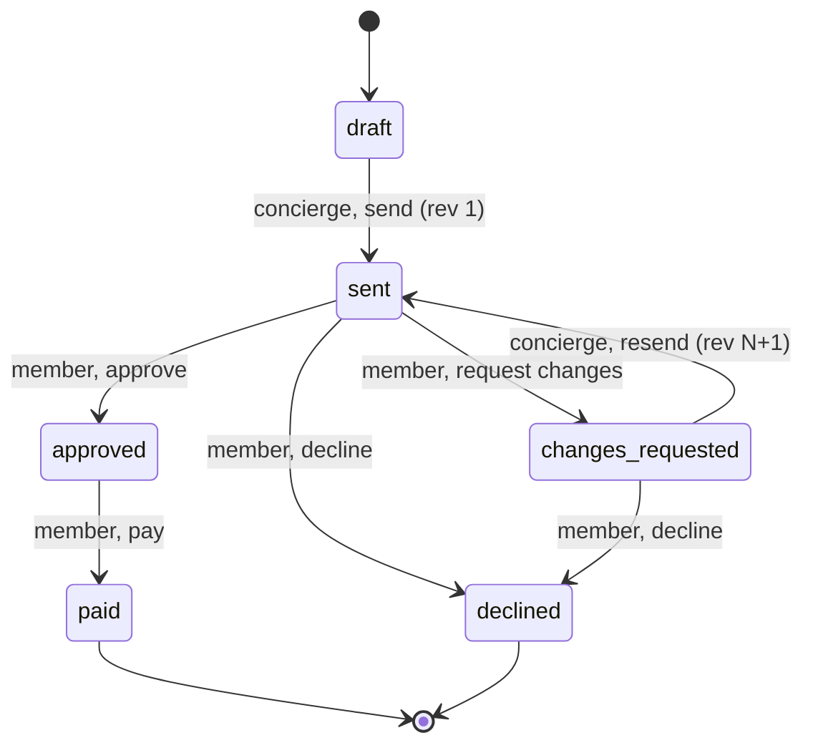
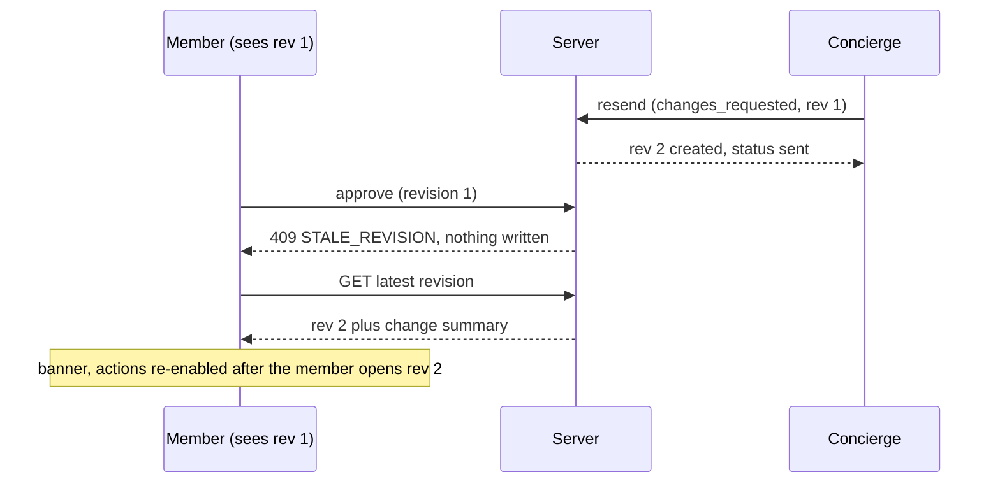

# Spec 001: Revision requests and proposal conversation

|                    |                                                                                                                                                                                                        |
| ------------------ | ------------------------------------------------------------------------------------------------------------------------------------------------------------------------------------------------------ |
| **Status**         | Draft, ready for review                                                                                                                                                                                |
| **Author**         | Bohdan Kopcha                                                                                                                                                                                          |
| **Date**           | 2026-11-24                                                                                                                                                                                             |
| **Implementation** | None yet. This document is the contract. Once built, behavior moves into the product docs and this file stays as the record ([appendix J](appendix.md#j-docs-to-update)).                              |
| **How to read**    | **At a glance**: 2 minutes. **Sections 1–7**: 10 minutes. [**Appendix**](appendix.md): reference (full edge cases, all decisions, acceptance tests, traceability, migration), read only what you need. |

---

## At a glance

**Problem.** A member can only say yes. A `sent` proposal is approved and paid, or it sits there. Real concierge work is a negotiation: move the spa to Tuesday, drop the excursion, ask about a dietary need.

**Feature.** Turn the one-way flow into a loop with a paper trail:

- The member can **request changes** or **decline**, always with a message.
- The concierge edits and **resends** a numbered **revision** with a cover message and a signature.
- Every proposal gets a **conversation**: messages from both sides and the proposal's own events in one chronological stream, shown in a chat-style window to both.

The central idea: **a revision is what the member approves; the conversation is the history of how it got there.** Both are append-only, so "the member approves exactly what they saw" survives the new flow.

**Six things worth a look** (the non-obvious parts):

1. **Stale-revision guard.** A member on revision 1 can't approve after the concierge resent revision 2. Every member action carries its revision; a mismatch is `409 STALE_REVISION` and writes nothing.
2. **The member reads the latest sent revision, not the working copy.** While the concierge edits after a request, the member never sees a half-edited itinerary.
3. **The guard is one atomic statement.** `currentRevision` lives on the proposal, so the write is `updateMany where { id, status, currentRevision }`. No read-then-write window.
4. **Every transition writes its conversation entry in the same transaction.** A status can't change without its entry, or the reverse.
5. **The transition table becomes an edge list.** Today it maps one status to one successor and can't branch. UI buttons are still derived from it, now by actor.
6. **Resending unchanged content is allowed.** Otherwise the loop dead-ends on "we can't change that".

**Scope.** **P1** is the minimum coherent feature: request changes, decline, revisions, resend, and the conversation stream that records them. **P2** completes it: free chat messages, polling, revision browsing. Not doing: real-time delivery, unread counters, message edit/delete, real authentication ([appendix A](appendix.md#a-non-goals)).

---

## 1. Scenarios

| ID   | As a      | I want to                                                     | So that                                                | Pri |
| ---- | --------- | ------------------------------------------------------------- | ------------------------------------------------------ | --- |
| US-1 | member    | ask for changes, or decline, with a note                      | the itinerary fits what I want, or I can leave cleanly | P1  |
| US-2 | concierge | see the request next to the itinerary and resend with my name | the member knows what changed and who answered         | P1  |
| US-3 | member    | be protected from approving a version I haven't seen          | I never pay for a surprise                             | P1  |
| US-4 | both      | exchange short messages and browse earlier revisions          | small questions don't need a new revision              | P2  |

Terms used below: **working copy** (the note and items the concierge edits), **revision** (an immutable snapshot taken at every send, numbered from 1), **conversation** (the proposal's ordered, append-only list of **entries**). Entry kinds are in [appendix B](appendix.md#b-entry-kinds).

## 2. Requirements

Keywords follow RFC 2119. Every requirement is traced to a test in [appendix I](appendix.md#i-test-plan-and-traceability).

| ID    | Requirement                                                                                                                                                                                                                                                                                                                                  | Pri |
| ----- | -------------------------------------------------------------------------------------------------------------------------------------------------------------------------------------------------------------------------------------------------------------------------------------------------------------------------------------------- | --- |
| FR-1  | A member MUST be able to request changes on a `sent` proposal with a message (1–2000 characters after trim). Status becomes `changes_requested`.                                                                                                                                                                                             | P1  |
| FR-2  | A member MUST be able to decline a `sent` or `changes_requested` proposal with a message (same limits). Status becomes `declined`, terminal.                                                                                                                                                                                                 | P1  |
| FR-3  | In `changes_requested` the concierge MUST be able to edit note and items (same validation as a draft) and resend: at least one item, a cover message (1–2000), a signature (1–60). One transaction creates revision N+1, sets `sent`, logs the email and appends the entry. Unchanged content is allowed and labeled "No itinerary changes". | P1  |
| FR-4  | Every send MUST create an immutable revision. No code path updates or deletes one.                                                                                                                                                                                                                                                           | P1  |
| FR-5  | The member page MUST render the latest revision, never the working copy.                                                                                                                                                                                                                                                                     | P1  |
| FR-6  | Every member transition (approve, pay, request changes, decline) MUST carry the revision on screen. If it is not the latest, reject with `STALE_REVISION` and write nothing.                                                                                                                                                                 | P1  |
| FR-7  | The concierge MUST be able to open any revision read-only with a change summary against the previous one (items added, removed, total difference).                                                                                                                                                                                           | P2  |
| FR-8  | A sent proposal MUST have exactly one conversation (a draft has none): chat entries, transition entries and system events in one stream ordered by `(createdAt, id)`. Entries are immutable.                                                                                                                                                 | P1  |
| FR-9  | Member and concierge MUST be able to post chat entries while the conversation is open (`sent`, `changes_requested`, `approved`); it is read-only in `paid` and `declined`. One function decides, shared by server and UI.                                                                                                                    | P2  |
| FR-10 | Entry text MUST be plain text: escaped on render, line breaks preserved, never HTML or Markdown. Max 2000 characters; a conversation holds at most 500 entries.                                                                                                                                                                              | P1  |
| FR-11 | A concierge entry MUST store its signature as typed. A member entry MUST take the member's name from the database, never from the request.                                                                                                                                                                                                   | P1  |
| FR-12 | Posting a chat entry MUST be idempotent per client-generated id, so a retry after a lost response never duplicates it.                                                                                                                                                                                                                       | P2  |
| FR-13 | While a tab is visible and the conversation is open, a new entry MUST reach the other party within 10 seconds.                                                                                                                                                                                                                               | P2  |
| FR-14 | Member page: a conversation sheet, **Request changes** and **Decline**, a "new version" banner, and a change summary on revisions 2 and later.                                                                                                                                                                                               | P1  |
| FR-15 | Concierge dashboard: a Conversation tab, the member's latest request pinned above the builder, a **Reply & resend** dialog showing the change summary, and a list with the new statuses, revision number and last activity.                                                                                                                  | P1  |
| FR-16 | The resend email preview MUST contain the revision number, the cover message, the signature and the absolute proposal link.                                                                                                                                                                                                                  | P1  |
| FR-17 | Optimistic behavior follows [appendix F](appendix.md#f-surface-behavior-details).                                                                                                                                                                                                                                                            | P2  |

## 3. State machine

| #   | From → To                        | Actor     | Via                      | Preconditions                      | Side effects (one transaction)                                         |
| --- | -------------------------------- | --------- | ------------------------ | ---------------------------------- | ---------------------------------------------------------------------- |
| T1  | `draft` → `sent`                 | Concierge | `POST …/send`            | ≥ 1 item                           | Revision 1, `currentRevision = 1`, `sentAt`, `SentEmail`, `sent` entry |
| T2  | `sent` → `approved`              | Member    | `PATCH …`                | `revision` is latest               | `approvedAt`, `approved` entry                                         |
| T3  | `sent` → `changes_requested`     | Member    | `POST …/request-changes` | `revision` is latest, message      | `changes_requested` entry                                              |
| T4  | `sent` → `declined`              | Member    | `POST …/decline`         | `revision` is latest, message      | `declinedAt`, `declined` entry                                         |
| T5  | `changes_requested` → `sent`     | Concierge | `POST …/resend`          | ≥ 1 item, cover message, signature | Revision N+1, `currentRevision`, `SentEmail`, `revision_sent` entry    |
| T6  | `changes_requested` → `declined` | Member    | `POST …/decline`         | `revision` is latest, message      | as T4                                                                  |
| T7  | `approved` → `paid`              | Member    | `PATCH …`                | `revision` is latest               | `paidAt`, `paid` entry                                                 |

Everything else is illegal, including repeating the current status (`409 INVALID_TRANSITION`, as today).

| Status              | Editable               | Visible to member | Conversation | Terminal |
| ------------------- | ---------------------- | ----------------- | ------------ | -------- |
| `draft`             | yes                    | no                | none         | no       |
| `sent`              | no                     | latest revision   | open         | no       |
| `changes_requested` | **yes** (working copy) | latest revision   | open         | no       |
| `approved`          | no                     | latest revision   | open         | no       |
| `paid`              | no                     | latest revision   | read-only    | **yes**  |
| `declined`          | no                     | latest revision   | read-only    | **yes**  |

**Code model.** `TRANSITIONS` becomes a list of edges `{ from, to, actor, verb }`; `canTransition`, `isEditable` (now `draft` and `changes_requested`) and each surface's buttons derive from it. `PATCH` keeps only the payload-less member edges (approve, pay). The rest get dedicated verbs, for the same reason `sent` is reachable only through `/send`: an action with a payload or side effect must not be skippable.

**The race the design must win:**

## 4. Data model

Conceptual; exact columns live in `prisma/schema.prisma` once built ([details: appendix C](appendix.md#c-data-model-details)).

| Change                     | Purpose                                                                                                                |
| -------------------------- | ---------------------------------------------------------------------------------------------------------------------- |
| New `ProposalRevision`     | Immutable snapshot of note and items per send. Unique on `(proposalId, number)`.                                       |
| New `ProposalMessage`      | One conversation entry: kind, author role and name, body, revision, optional `clientId`.                               |
| `Proposal.currentRevision` | Denormalized on purpose: it makes the stale guard one atomic statement. Invariant: equals the highest revision number. |
| `Proposal.declinedAt`      | One-shot timestamp, like `approvedAt` and `paidAt`.                                                                    |
| `SentEmail.revision`       | Which revision each email delivered.                                                                                   |

Two rules: **repeatable events** (changes requested) live in the conversation, because a timestamp column would silently keep only the last one; and **outside `draft` and `changes_requested` the working copy equals the latest revision**, asserted by a test after every transition.

## 5. API

Contracts are zod schemas in `src/lib/schemas/`. Intent only here.

| Method and path                                | Purpose                                                                        |
| ---------------------------------------------- | ------------------------------------------------------------------------------ |
| `GET /api/proposals/[id]/messages`             | Conversation, oldest first. Empty for a draft.                                 |
| `POST /api/proposals/[id]/messages`            | Post a chat entry (`author`, `body`, optional `authorName`, `clientId`)        |
| `POST /api/proposals/[id]/request-changes`     | T3. Body: `revision`, `body`                                                   |
| `POST /api/proposals/[id]/decline`             | T4, T6. Body: `revision`, `body`                                               |
| `POST /api/proposals/[id]/resend`              | T5. Body: `authorName`, `body`                                                 |
| `GET /api/proposals/[id]/revisions`            | Revision list with change summaries                                            |
| `GET /api/proposals/[id]/revisions/[revision]` | One immutable revision (a number or `latest`). The member page reads `latest`. |

Existing routes: `PATCH` gains a required `revision`; `PUT` is allowed in `draft` and `changes_requested`; detail and summaries gain `currentRevision` (and `lastActivityAt`).

| HTTP | Code                  | When                                                                               |
| ---- | --------------------- | ---------------------------------------------------------------------------------- |
| 409  | `STALE_REVISION`      | A member action carries a revision that is not the latest. Names both numbers.     |
| 409  | `CONVERSATION_CLOSED` | Posting where the conversation is not open (draft, `paid`, `declined`) or is full. |

**Check order** for member actions: unknown id (404), body fails zod (400), status not a legal source (`INVALID_TRANSITION`), revision not latest (`STALE_REVISION`). Status is the more fundamental truth, so it is reported first.

## 6. Behavior by surface

Visual language follows [design.md](../../design.md): quiet and premium for the member, fast and dense for the concierge.

**Member (`/proposal/[id]`)**

| Status               | What the member sees                                                                               | Actions                                          |
| -------------------- | -------------------------------------------------------------------------------------------------- | ------------------------------------------------ |
| `sent`, revision 1   | Itinerary as today                                                                                 | **Approve**, **Request changes**, Decline (menu) |
| `sent`, revision ≥ 2 | Cover message and signature above the itinerary, a collapsible "What changed", a "Revision N" pill | Same                                             |
| `changes_requested`  | Last revision, read-only, "Changes requested" pill, "{Signature} is working on your request"       | Message, Decline                                 |
| `approved`           | Trip pass as today                                                                                 | **Pay & Lock In**, Message                       |
| `paid` / `declined`  | Confirmation as today / a quiet closing page. Conversation read-only.                              | none                                             |

- Request changes and Decline share one sheet with a mandatory message. Decline asks for explicit confirmation.
- When polling finds a newer revision, a banner appears and **actions stay disabled until the member opens it**. The server guard is the backstop, not the plan.

**Concierge (`/planning/[id]`)**

- The list shows new statuses (`changes_requested` reads as "needs you"), `Rev N` and last activity.
- In `changes_requested` the builder is editable with the member's request pinned above it, and the primary action is **Reply & resend** (cover message, signature, change summary).
- A Conversation tab sits beside the builder; a revisions list opens any version read-only.
- After a decline the builder is read-only with the reason. The way forward is a new proposal for the same reservation.

Optimism, polling and sheet details: [appendix F](appendix.md#f-surface-behavior-details).

## 7. Edge cases, decisions, open questions

**Edge cases** (selected; the full list of 14 is in [appendix D](appendix.md#d-edge-cases))

| #   | Situation                                              | Expected                                                                                           |
| --- | ------------------------------------------------------ | -------------------------------------------------------------------------------------------------- |
| E-1 | Approve and request-changes race                       | One wins by conditional write; the loser gets `INVALID_TRANSITION` and refetches. No orphan entry. |
| E-2 | Member acts on revision 1 after revision 2 was sent    | `STALE_REVISION`, nothing written, banner shown, typed text kept.                                  |
| E-3 | Two concierge tabs resend at once                      | One creates revision N+1; the other gets `INVALID_TRANSITION`. Unique number is the backstop.      |
| E-4 | Member declines while the concierge edits              | The next save returns `NOT_EDITABLE`; the builder shows the decline and its reason.                |
| E-6 | Resend with zero items                                 | `EMPTY_PROPOSAL` (422); full rollback, no revision, email or entry.                                |
| E-8 | Response lost after a successful chat post, then retry | Same `clientId`: the server returns the existing entry.                                            |

**Key decisions** (all twelve with rejected alternatives: [appendix E](appendix.md#e-decisions-and-alternatives))

| ID   | Decision                                                        | Rejected                                                                  |
| ---- | --------------------------------------------------------------- | ------------------------------------------------------------------------- |
| D-1  | Two member actions: request changes (loops), decline (terminal) | One "decline" that always loops                                           |
| D-2  | Immutable **revisions** under one proposal and one link         | New proposal per change; editing `sent` in place                          |
| D-4  | **Polling**, not WebSocket/SSE                                  | Push: no long-lived-connection infrastructure, no auth to scope a channel |
| D-7  | `currentRevision` on `Proposal` for an atomic guard             | Read the latest revision, then write                                      |
| D-8  | Member reads the **latest revision**                            | Member reads the working copy                                             |
| D-10 | Unchanged resend allowed                                        | Reject with `NO_CHANGES`                                                  |

**Open questions** (each has a default so implementation isn't blocked)

| ID   | Question                                                  | Proposed default                                                                                 |
| ---- | --------------------------------------------------------- | ------------------------------------------------------------------------------------------------ |
| OQ-1 | Request changes or decline from `approved`?               | No. Approval is a commitment; retraction is a separate feature.                                  |
| OQ-2 | Conversation open after `paid`?                           | Read-only. Post-payment changes are another workflow.                                            |
| OQ-3 | Should a concierge chat reply also log a simulated email? | No, only resends do. A member must revisit the link to see replies; name this gap in the README. |
| OQ-4 | Can the concierge end a stalled negotiation?              | Out of scope; belongs with cancel/expire.                                                        |
